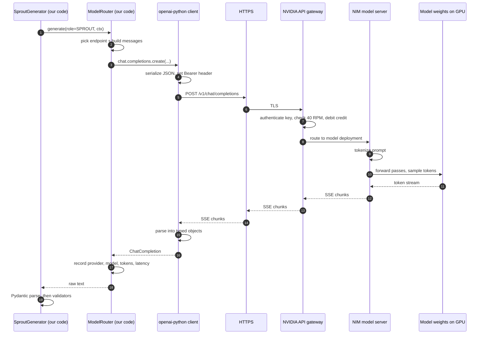
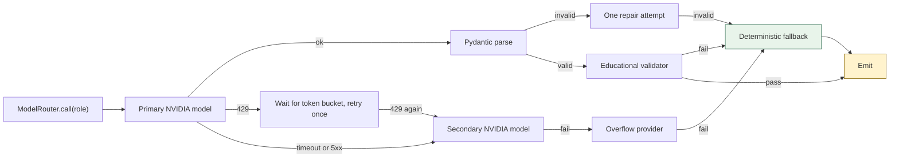
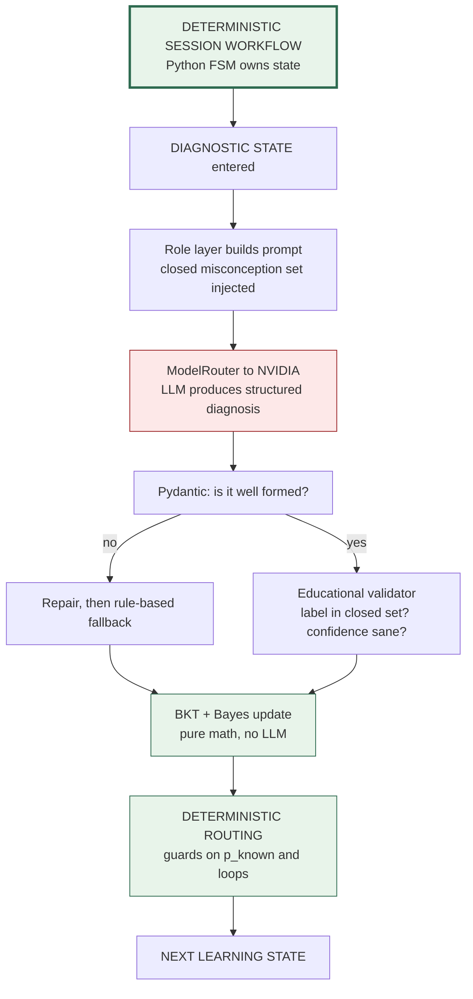
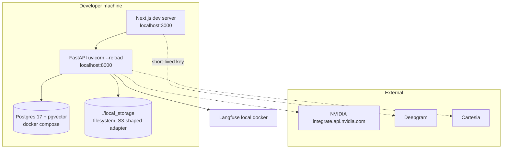
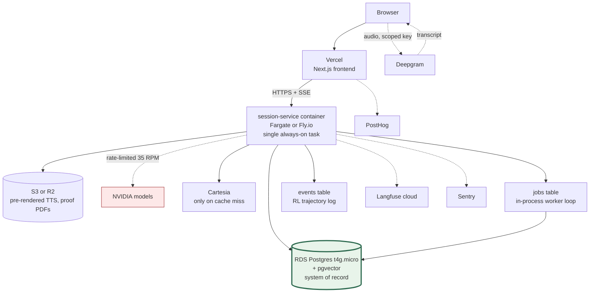

# PROTÉGÉ — Engineering Clarification Addendum
### v1.1 · Supersedes specific decisions in v1.0 · Sept 5, 2026

This document does not change the product. It corrects and sharpens the engineering spec.

**Three corrections to v1.0 up front, because you should know what changed:**

1. **XState was a mistake in v1.0.** I specified "XState v5 in-process" alongside a **Python/FastAPI** backend. XState is a TypeScript library. That is an inconsistency I shipped and you should not inherit it. The session FSM belongs in **plain Python** (§3.9).
2. **My one-line dismissal of LangGraph — "LangGraph lets the LLM choose the path" — was imprecise and I'm retracting it.** LangGraph supports fully deterministic routing. The real reasons to skip it here are different and narrower (§3.8).
3. **Runtime inference moves to NVIDIA-hosted open models.** Anthropic is no longer in the request path. Fable 5.1 is now strictly an **offline development resource**, never a runtime dependency.

---

# 1. SDK vs API vs MODEL

## 1.1 The five terms, precisely

| Term | What it actually is | Physical location | Costs money? |
|---|---|---|---|
| **Model** | A set of trained weights plus an inference graph. Mathematically, a function from token sequences to a probability distribution over next tokens. `llama-3.3-70b-instruct` is ~70 billion floating-point numbers. | On GPUs, in a datacenter | Only when executed |
| **Model endpoint** | One specific, addressable, running deployment of one model. Identified by `(base_url, model_id)`. `https://integrate.api.nvidia.com/v1` + `meta/llama-3.3-70b-instruct` is an endpoint. | A URL | — |
| **Inference API** | The **wire contract**: the HTTP method, path, JSON request shape, JSON response shape, error codes, streaming format. "OpenAI Chat Completions API" is a contract, not a company's product. | A specification | — |
| **Provider** | The organisation that owns the GPUs, runs the model server, meters usage, enforces rate limits, and publishes the endpoint. NVIDIA, Anthropic, OpenAI, or your own vLLM box. | An operator | Bills you |
| **SDK / client** | A library **in your language** that constructs the HTTP request, sets auth headers, retries on 429/5xx, parses SSE streams, and gives you typed objects instead of raw dicts. It is ordinary open-source code running on your server. | `site-packages/` on your machine | **No** |

**The single most important distinction:** the SDK runs on *your* computer and is free; the model runs on *their* GPUs and is metered. Installing `pip install anthropic` costs nothing and calls nothing. You are billed only when bytes cross the network to a provider's inference endpoint and tokens get processed.

## 1.2 What physically happens on one Protégé LLM call



Steps 1–4 and 15–18 are **your code and free**. Steps 9–12 are **the provider's GPUs and metered**. Everything between is transport.

## 1.3 What the Anthropic SDK actually provides

`anthropic` (MIT, PyPI) gives you: typed request/response models, `client.messages.stream()`, automatic retry with exponential backoff on 429/500/529, a structured exception hierarchy (`RateLimitError`, `APIStatusError`, `OverloadedError`), tool-use and prompt-caching parameter helpers, and async support. That is *all* it is — an HTTP client with good ergonomics.

**Is it free?** Yes, entirely. Open-source library, no key needed to install.
**What incurs cost?** Only tokens processed by Anthropic's endpoint, at Anthropic's published rates.
**Do we need it if we use NVIDIA-hosted models?** **No.** Remove the dependency from the runtime service. Keep it only in the offline `tools/authoring/` package where Fable 5.1 is used by developers.

## 1.4 How our code should talk to NVIDIA

NVIDIA's API catalogue exposes an **OpenAI-compatible Chat Completions endpoint** at `https://integrate.api.nvidia.com/v1`, authenticated with `Authorization: Bearer nvapi-...`, with models addressed by catalogue path (`meta/llama-3.3-70b-instruct`, `nvidia/nemotron-...`, `moonshotai/kimi-k2.6`, etc.). Free-tier accounts get a credit allowance (commonly reported as ~1,000 credits on signup, up to ~5,000 on request) and a **40 requests-per-minute** rate limit.

**Decision: use the `openai` Python SDK with an overridden `base_url`. Do not use a NVIDIA-specific SDK, and do not use `langchain-nvidia-ai-endpoints`.**

Why:
- The `openai` client already speaks the exact wire contract NVIDIA implements. Zero adapter code.
- It is the most battle-tested Python HTTP client for this contract (retries, streaming, timeouts).
- A NVIDIA-specific SDK or a LangChain integration would couple our code to one provider, which is precisely what our ModelRouter exists to prevent.
- `langchain-nvidia-ai-endpoints` drags in the LangChain object model for no benefit — we are not using LangChain.

Self-hosting NIM containers is a different product (you rent GPUs and run the model yourself). Out of scope now; note that the *same model ID* works either way, which is a genuine future benefit.

## 1.5 The layering, applied to Protégé

```
Application layer      SessionOrchestrator (Python FSM)
                              │  "I am in TEACH_BACK and need Sprout to speak"
Role layer             SproutGenerator / Diagnostician / Coach / Reporter
                              │  owns the prompt, the Pydantic schema, the validators
Routing layer          ModelRouter
                              │  role → (provider, model_id), fallback chain, metering
Provider adapter       NvidiaProvider / AnthropicProvider / LocalProvider
                              │  normalises to one internal call signature
SDK / client           openai-python  (or anthropic-python)
                              │  HTTP, auth, retries, SSE parsing
Inference API          POST /v1/chat/completions   (OpenAI contract)
                              │
Model endpoint         integrate.api.nvidia.com/v1 + "meta/llama-3.3-70b-instruct"
                              │
Model                  the weights, executing on NVIDIA's GPUs
```

**Responsibility boundaries, stated as rules:**
- The **application layer** never knows a model name exists.
- The **role layer** owns prompts and schemas; it knows *what good output is*, not *who produces it*.
- The **ModelRouter** is the only place a provider or model string appears.
- The **provider adapter** is the only place SDK-specific types appear.
- The **SDK** never makes a pedagogical decision.

## 1.6 The provider abstraction (concrete)

```python
# protege/llm/base.py
from typing import Protocol, Sequence, Literal
from dataclasses import dataclass, field

@dataclass(frozen=True)
class Message:
    role: Literal["system", "user", "assistant"]
    content: str

@dataclass
class LLMResult:
    text: str
    provider: str
    model_id: str
    tokens_in: int
    tokens_out: int
    latency_ms: int
    finish_reason: str
    raw_id: str | None = None

class LLMProvider(Protocol):
    name: str
    def complete(
        self,
        messages: Sequence[Message],
        *,
        model_id: str,
        max_tokens: int,
        temperature: float,
        timeout_s: float,
        json_schema: dict | None = None,
    ) -> LLMResult: ...
```

```python
# protege/llm/providers/nvidia.py
import os, time
from openai import OpenAI, APIStatusError, APITimeoutError, RateLimitError
from protege.llm.base import LLMProvider, LLMResult, Message
from protege.llm.errors import ProviderRateLimited, ProviderTimeout, ProviderFailed

class NvidiaProvider(LLMProvider):
    name = "nvidia"

    def __init__(self) -> None:
        self._client = OpenAI(
            base_url="https://integrate.api.nvidia.com/v1",
            api_key=os.environ["NVIDIA_API_KEY"],   # nvapi-...
            max_retries=0,        # we own retry policy at the router level
        )

    def complete(self, messages, *, model_id, max_tokens, temperature,
                 timeout_s, json_schema=None) -> LLMResult:
        kwargs: dict = {}
        if json_schema is not None:
            # Support varies by model on NIM. Router degrades to prompt-only
            # JSON mode when a model rejects this parameter. See §2.5.
            kwargs["response_format"] = {
                "type": "json_schema",
                "json_schema": {"name": "out", "schema": json_schema, "strict": True},
            }
        t0 = time.perf_counter()
        try:
            r = self._client.chat.completions.create(
                model=model_id,
                messages=[{"role": m.role, "content": m.content} for m in messages],
                max_tokens=max_tokens,
                temperature=temperature,
                timeout=timeout_s,
                **kwargs,
            )
        except RateLimitError as e:
            raise ProviderRateLimited("nvidia", model_id) from e
        except APITimeoutError as e:
            raise ProviderTimeout("nvidia", model_id) from e
        except APIStatusError as e:
            raise ProviderFailed("nvidia", model_id, e.status_code) from e

        u = r.usage
        return LLMResult(
            text=r.choices[0].message.content or "",
            provider=self.name,
            model_id=model_id,
            tokens_in=getattr(u, "prompt_tokens", 0),
            tokens_out=getattr(u, "completion_tokens", 0),
            latency_ms=int((time.perf_counter() - t0) * 1000),
            finish_reason=r.choices[0].finish_reason or "unknown",
            raw_id=r.id,
        )
```

An `AnthropicProvider` implementing the same `LLMProvider` protocol is ~40 lines using the `anthropic` SDK. **Swapping providers is a config change, not a code change** — which is exactly the line you want to say in the demo when a judge asks "what if this needs to be Claude in production?"

```python
# protege/llm/router.py
ROLE_POLICY = {
    "SPROUT":        ["nvidia:meta/llama-3.3-70b-instruct",
                      "nvidia:nvidia/nemotron-3-super-120b-a12b",
                      "authored_fallback"],
    "DIAGNOSTICIAN": ["nvidia:nvidia/nemotron-3-super-120b-a12b",
                      "nvidia:meta/llama-3.3-70b-instruct",
                      "rule_based_distractor_map"],
    "COACH":         ["nvidia:meta/llama-3.1-8b-instruct", "authored_verbatim"],
    "REPORTER":      ["nvidia:meta/llama-3.3-70b-instruct", "pure_template"],
    "MODERATION":    ["local:blocklist+classifier"],   # never leaves our box
}
```

---

# 2. NVIDIA MODEL INTEGRATION

## 2.1 Where it sits

NVIDIA is a **provider** behind the ModelRouter. Nothing above the router changes. The Session Orchestrator, the validators, the mastery engine, and the evidence ledger are all provider-blind.

## 2.2 Role → model mapping

| Pedagogical role | Task shape | NVIDIA model class | Why this size |
|---|---|---|---|
| **Sprout** | Render one chosen misconception as ≤30 words in character | 70B instruct | Style + constraint following; not reasoning-heavy |
| **Diagnostician** | Classify into a **closed set** of ~8 misconception IDs + confidence | Largest reasoning-capable model available on the free tier | Highest-stakes inference; but the closed output space is what makes a 70B-class open model viable here |
| **Coach** | Rewrite an authored hint for this child | 8B instruct | Trivial rewrite; keep it cheap and fast |
| **Reporter** | Prose from a structured evidence bundle | 70B instruct | Grounded generation, low creativity |
| **Moderation** | Safety screen every child turn | **Local**, not NVIDIA | 40 RPM is too scarce to spend on moderation; use a local classifier + blocklist |

**This is the payoff of a v1.0 decision.** Because we constrained the Diagnostician to emit a label from a closed set rather than free-form analysis, an open 70B model is a plausible substitute for Opus 5. **You must re-measure F1 on the golden set with the actual model — do not assume the ≥0.75 gate carries over.** If it doesn't clear, the fix is a better-specified prompt with few-shot examples per misconception, not a bigger model.

## 2.3 The two constraints that actually shape the design

**40 requests per minute.** One full Protégé session makes roughly 25–40 LLM calls over ~12 minutes — about 3 RPM average, but **bursty**. Two or three concurrent sessions during a live demo will hit the ceiling. Mitigations, in order:
1. A process-wide **token-bucket limiter** at 35 RPM (headroom below the cap), with a small FIFO queue. Requests wait rather than fail.
2. Move moderation **off** the LLM path entirely (local classifier).
3. Cache Sprout utterances by `(misconception_id, turn_index, item_id)` — the pool is finite, so hit rate climbs fast.
4. Never demo with concurrent live users. Record the demo.

**Credit allowance.** Reported as ~1,000 credits on signup (≈1 credit per call), extendable to ~5,000 on request. At ~30 calls/session that is **roughly 30 sessions** — and your evaluation suite alone (200 Sprout fidelity generations + 120 golden-set diagnoses + red-team runs) consumes 300+. This is a real budget, not a formality.

> **Action for Day 1:** create the account, request the credit increase immediately (it takes time), verify the actual metering and rate limit at `build.nvidia.com/settings` rather than trusting any blog figure, and register a **second free provider** as overflow so a depleted quota cannot end your hackathon.

**Cache every eval result to disk keyed by prompt hash.** Re-running the suite after a prompt tweak should only re-execute changed cases.

## 2.4 Fallback chain



The deterministic fallback is role-specific and **always exists**: Sprout → authored utterance pool; Diagnostician → rule-based distractor→misconception mapping; Coach → authored hint verbatim; Reporter → pure template. A total LLM outage degrades Protégé to a scripted-but-correct product. It never errors.

## 2.5 Structured output enforcement

**Do not assume `response_format: json_schema` works.** Support for constrained decoding varies per model on NIM. Design a three-tier strategy and detect capability once at startup:

```python
# protege/llm/structured.py
from pydantic import BaseModel, ValidationError
import json, re

class SproutTurn(BaseModel):
    utterance: str
    exhibits: str          # misconception code
    emotion: str
    confidence_shown: str

def parse_strict(raw: str, model_cls: type[BaseModel]) -> BaseModel:
    m = re.search(r"\{.*\}", raw, re.S)      # tolerate prose wrappers
    if not m:
        raise ValidationError.from_exception_data(model_cls.__name__, [])
    return model_cls.model_validate(json.loads(m.group(0)))

def call_structured(router, role, messages, model_cls, max_repairs=1):
    schema = model_cls.model_json_schema()
    result = router.call(role, messages, json_schema=schema)   # tier 1
    for _ in range(max_repairs + 1):
        try:
            return parse_strict(result.text, model_cls), result
        except (ValidationError, json.JSONDecodeError) as e:
            repair = messages + [
                Message("assistant", result.text),
                Message("user", f"That was not valid. Return ONLY JSON "
                                f"matching this schema. Error: {e}"),
            ]
            result = router.call(role, repair, json_schema=schema)  # tier 2
    raise StructuredOutputFailed(role)                              # tier 3
```

Tier 1 = native constrained decoding if the model supports it. Tier 2 = JSON-mode prompt + parse + one repair. Tier 3 = deterministic fallback. Every tier-3 event increments `fallback_rate`, which is on the AI-quality dashboard.

## 2.6 Where deterministic validation happens

**After Pydantic, always. Pydantic checks shape; it does not check truth.**

```
LLM text
  → [1] JSON extraction + Pydantic  ..... is it well-formed?
  → [2] Educational validator ........... does it exhibit the ASSIGNED misconception?
                                          does it leak the correct answer?  (exact +
                                          numeric-equivalence check, zero tolerance)
                                          is reading level ≤ G3?
  → [3] Safety validator ................ moderation on output
  → [4] Deterministic core .............. SymPy answer check, BKT update,
                                          mastery threshold, reward eligibility
  → child
```

Stages 2–4 contain **no LLM calls and no model output is trusted past stage 1**. This is unchanged from v1.0 and is the spine of the architecture.

## 2.7 Metadata to record on every call

Extend `model_runs` from v1.0 with provider fields:

```sql
ALTER TABLE model_runs
  ADD COLUMN provider          text NOT NULL,      -- 'nvidia'
  ADD COLUMN endpoint_base_url text NOT NULL,
  ADD COLUMN model_id          text NOT NULL,      -- 'meta/llama-3.3-70b-instruct'
  ADD COLUMN attempt_index     int  NOT NULL DEFAULT 0,
  ADD COLUMN fallback_reason   text,               -- rate_limit|timeout|schema|validator
  ADD COLUMN credits_estimated numeric(8,3),
  ADD COLUMN structured_mode   text;               -- native|prompt|failed
```

Every row also carries `pedagogical_role`, `prompt_version`, `tokens_in/out`, `latency_ms`, `trace_id`. This lets you answer, at demo time, "what does diagnosis cost and how often does it fall back?" — with a number.

## 2.8 Failure taxonomy

| Failure | Detection | Immediate action | Child sees |
|---|---|---|---|
| 429 rate limit | `RateLimitError` | Token bucket wait → retry once → secondary model | Nothing (Sprout "thinks" briefly) |
| Credits exhausted | 402/403 or quota error | Switch to overflow provider; alert the team loudly | Nothing |
| Timeout >2.5 s | `APITimeoutError` | Secondary model, no retry on primary | Nothing |
| 5xx | `APIStatusError` | Circuit breaker opens after 3 consecutive; secondary | Nothing |
| Malformed JSON | Pydantic | One repair attempt → deterministic fallback | Nothing |
| Schema-valid but pedagogically wrong | Educational validator | Authored utterance | Nothing |
| Answer leak | Deterministic string/numeric check | Discard, authored utterance, **log as severity-high** | Nothing |
| Model deprecated/removed | Startup health check | Fail deploy, not runtime | Nothing |

**Add a startup health check** that calls every model in `ROLE_POLICY` with a two-token prompt and refuses to boot if a primary is unreachable. Discovering a renamed model ID at 11 PM on Sept 17 is a preventable disaster.

---

# 3. LANGGRAPH vs DETERMINISTIC WORKFLOW — DONE PROPERLY

## 3.1 What is a deterministic workflow?

A workflow where **the next step is a pure function of current state and the incoming event, computed by code you wrote**. Given the same state and event, you get the same transition every time. It is inspectable before it runs, testable exhaustively, and replayable.

## 3.2 What is a finite state machine?

A 5-tuple: a finite set of states `S`, an input alphabet `E`, a transition function `δ: S × E → S`, a start state, and accepting/terminal states. The word that matters is **finite** — you can enumerate every state and every legal transition, and therefore you can prove things about it (e.g. "TEACH_BACK is unreachable when `P(L) < 0.35`").

A **statechart** (Harel) extends this with hierarchy, parallel regions, guards, and entry/exit actions. Protégé's session graph is a statechart: 18 states, guarded transitions, timeouts.

## 3.3 What is XState?

A **TypeScript/JavaScript** library implementing statecharts. Gives you serializable machine definitions, guards, actions, invoked actors, and a visualiser. It is excellent — **and it does not run in Python.** That is the v1.0 error.

## 3.4 What is LangGraph?

A Python/JS library for building **stateful graphs of computation**. You define a typed shared state object, register nodes (functions that read state and return partial updates), and connect them with edges. Edges may be **static** (`A → B`) or **conditional** (a plain function that reads the state and returns the name of the next node).

What it actually adds over a hand-rolled loop:
- **Checkpointing** — persist graph state after each node, resume later.
- **Interrupts / human-in-the-loop** — pause the graph, wait for external input, resume.
- **Time-travel and replay** — re-run from any checkpoint.
- **Streaming** of intermediate node outputs.
- **Subgraphs** — compose reusable graph fragments.
- **Cycles** — first-class support for loops, which is what makes agent loops expressible.

**Crucially: LangGraph is not inherently agentic.** A LangGraph graph whose conditional edges are all deterministic `if` statements is a deterministic workflow engine. It is often *used* to build agents because cycles + tool nodes make agent loops easy, but that is a usage pattern, not a property of the library.

## 3.5 What is an agentic workflow?

One where **the control flow itself is chosen at runtime by a model.** The model is handed a set of tools and a goal, and it decides which tool to call, with what arguments, in what order, and when to stop. The edge set is not written by you in advance — it is generated turn by turn.

The clean test: **who writes the edge?**
- You write it, at authoring time → deterministic workflow.
- The model writes it, at runtime → agentic.
- You write a *bounded menu* of edges and the model picks one → constrained agentic (the useful middle).

## 3.6 What determines the next step, per architecture

| Architecture | Next step decided by | Predictable before running? | Provable? |
|---|---|---|---|
| Ordinary control flow | The interpreter following your source | Yes | Yes |
| FSM / statechart | `δ(state, event)` — your transition table | Yes | Yes, exhaustively |
| LangGraph with deterministic edges | Your edge functions | Yes | Yes |
| LangGraph with an LLM router node | Model output selecting a node name | No | Only within the node set |
| Full agent loop | Model choosing tools until it stops | No | Only tool permissions |

## 3.7 Can LangGraph implement deterministic routing?

**Yes, completely.** This is why the v1.0 one-liner was wrong.

```python
def route_after_explanation(state: SessionState) -> str:
    p = state.mastery.p_known
    if p < 0.35 and state.loops < 3:  return "guided_learning"
    if p < 0.35:                      return "escalate_to_human"
    if p <= 0.80:                      return "sprout_setup"
    return "sprout_setup_hard"

graph.add_conditional_edges("explanation", route_after_explanation)
```

That is our exact READINESS choice node, in LangGraph, with zero model involvement in routing. It would work.

## 3.8 So when does LangGraph earn its weight — and why not here?

**It earns its weight when you need:** durable execution across hours or days; human-in-the-loop interrupts mid-graph; replay/time-travel debugging of complex runs; reusable subgraphs across many workflows; or a genuinely dynamic agent loop.

**Why Protégé skips it (the accurate reasons):**

1. **Our graph is small and static.** 18 states, ~25 edges, all enumerable. A dict-based transition table plus guard functions is ~150 lines and needs no dependency.
2. **We need a queryable audit trail, not an opaque checkpoint blob.** LangGraph's checkpointer serialises graph state. We need `session_states` as typed, indexed, joinable rows because the evidence ledger, the tutor briefing, and the RL trajectory log all query it. We'd end up maintaining both.
3. **Latency budget.** Transitions must be sub-millisecond in the request path. A checkpoint write per node adds DB round-trips we don't need for a 12-minute session.
4. **13 days.** A new dependency and its mental model is a cost with no offsetting benefit here.

**What would change my mind:** if sessions became multi-day resumable, or if we added a genuinely dynamic tutoring agent that picks among many tools, LangGraph becomes the right tool and I'd adopt it. It is not wrong; it is not yet earning its weight. Say it that way to a judge — it's a much stronger answer than dismissing the library.

## 3.9 Corrected decision: plain Python FSM

```python
# protege/session/machine.py
from enum import StrEnum
from dataclasses import dataclass
from typing import Callable

class S(StrEnum):
    ARRIVAL = "ARRIVAL"; SPROUT_TEASE = "SPROUT_TEASE"; DIAGNOSTIC = "DIAGNOSTIC"
    DISCOVERY = "DISCOVERY"; GUIDED_LEARNING = "GUIDED_LEARNING"
    PRACTICE = "PRACTICE"; EXPLANATION = "EXPLANATION"
    SPROUT_SETUP = "SPROUT_SETUP"; SPROUT_SETUP_HARD = "SPROUT_SETUP_HARD"
    TEACH_BACK = "TEACH_BACK"; COACH_ASSIST = "COACH_ASSIST"
    REFLECTION = "REFLECTION"; INDEPENDENT_VERIFY = "INDEPENDENT_VERIFY"
    TRANSFER = "TRANSFER"; MASTERY_DECISION = "MASTERY_DECISION"
    REWARD = "REWARD"; SUMMARY = "SUMMARY"; RETRIEVAL_SCHEDULE = "RETRIEVAL_SCHEDULE"
    COMPLETE = "COMPLETE"; ESCALATE_TO_HUMAN = "ESCALATE_TO_HUMAN"
    ABANDONED = "ABANDONED"

@dataclass(frozen=True)
class Transition:
    to: S
    guard: Callable[["SessionState"], bool] = lambda s: True

TRANSITIONS: dict[tuple[S, str], list[Transition]] = {
    (S.EXPLANATION, "explanation_captured"): [
        Transition(S.ESCALATE_TO_HUMAN, lambda s: s.loops >= 3),
        Transition(S.GUIDED_LEARNING,   lambda s: s.p_known < 0.35),
        Transition(S.SPROUT_SETUP,      lambda s: s.p_known <= 0.80),
        Transition(S.SPROUT_SETUP_HARD),          # ordered; first guard wins
    ],
    # ...
}

def step(state: "SessionState", event: str) -> S:
    for t in TRANSITIONS.get((state.current, event), []):
        if t.guard(state):
            return t.to
    raise IllegalTransition(state.current, event)
```

Every transition is appended to `session_states`. Golden-trace tests replay recorded sessions and assert identical sequences. **XState remains optional on the frontend for UI-only state**, mirroring — never authoring — the server's decisions.

## 3.10 The four concepts, disentangled

| Concept | Question it answers | In Protégé |
|---|---|---|
| **Program control flow** | What line runs next? | Python executing the session service |
| **Workflow orchestration** | What business step comes next, given state? | The FSM: PRACTICE → EXPLANATION → READINESS |
| **Agent orchestration** | Which tool/subtask should be invoked now, decided at runtime by a model? | **Nothing in Protégé does this.** Deliberately |
| **LLM reasoning** | Given this context, what text/label should be produced? | Sprout's utterance; the Diagnostician's label |

The Diagnostician *reasons*; it does not *orchestrate*. That distinction is the whole architecture.

## 3.11 The deterministic path, drawn



**Contrast — a genuinely agentic version we are NOT building:** the model receives tools `[get_learner_history, generate_item, ask_sprout, run_assessment, end_session]` and a goal "help Ava master fractions," then decides each turn which to call and when to stop. That system can discover better teaching sequences than we anticipated. It can also loop forever, skip verification, over-hint, or end a session arbitrarily — and you cannot prove it won't. For a product whose entire claim is *verified* learning for children, that trade is wrong.

## 3.12 Could all three implement Protégé's graph?

Yes — XState (in a TS service), plain Python, and LangGraph are all capable of expressing this exact statechart. The choice is not about capability. It is about which one gives you an auditable, queryable, low-latency, dependency-light representation inside a Python service in 13 days. That is plain Python.

---

# 4. PROTÉGÉ SESSION WORKFLOW — EXPLICIT BOUNDARY

| Stage | Owner | Deterministic? | LLM? | Agentic? | Data produced | What decides the next transition |
|---|---|---|---|---|---|---|
| **ARRIVAL** | App logic | ✅ Fully | ❌ | ❌ | `sessions` row, loaded learner state | Profile load completes |
| **SPROUT_TEASE** | App + pre-rendered TTS | ✅ Fully | ❌ (audio cached) | ❌ | `turns` (system) | 8-second timer |
| **DIAGNOSTIC** | App + BKT | ✅ selection, ✅ scoring | ❌ | ❌ | `responses`, prior `mastery_estimates`, `misconception_beliefs` | 3–5 items answered, or 180 s timeout |
| **DISCOVERY** | Frontend | ✅ Fully | ❌ | ❌ | `turns` (manipulative trace) — no scoring | Child action or 90 s |
| **GUIDED_LEARNING** | App + Coach | ✅ selection; ⚠️ LLM phrasing only | ✅ Coach (rewrite of an **authored** hint) | ❌ | `interventions`, `turns` | Worked example completed |
| **PRACTICE** | Policy + validator | ✅ item selection (Elo), ✅ scoring (SymPy) | ❌ | ❌ | `responses`, updated `mastery_estimates` | 4 items attempted, or 3 consecutive errors |
| **EXPLANATION** | Diagnostician | ⚠️ **Probabilistic** | ✅ **Yes — core inference** | ❌ | `explanations`, `diagnoses`, `memory_items` + embedding | Evidence captured (any of 4 modalities) |
| **READINESS** (choice) | FSM guards | ✅ Fully | ❌ | ❌ | `policy_decisions` row | `p_known` band + `loops` count — **pure code** |
| **SPROUT_SETUP** | Policy | ✅ Fully — misconception chosen by **code** | ❌ | ❌ | `sprout_profiles`, `teaching_episodes` opened | Configuration complete |
| **TEACH_BACK** | Sprout + Diagnostician | ⚠️ Mixed | ✅ Both (generation + classification) | ❌ | `turns`, per-turn `diagnoses`, updated `misconception_beliefs` | Resolution belief crosses threshold, or 6-turn cap |
| **COACH_ASSIST** | Coach | ✅ selection; LLM phrasing | ✅ | ❌ | `interventions` | Hint delivered → return to TEACH_BACK |
| **REFLECTION** | Classifier | ⚠️ Probabilistic (closed set) | ✅ Light | ❌ | `turns`, calibration signal | Card selected or skipped |
| **INDEPENDENT_VERIFY** | Validator + BKT | ✅ **Fully — no LLM permitted** | ❌ | ❌ | `responses` (unaided=true, weight 3×), `evidence` | 3 items attempted |
| **TRANSFER** | Validator | ✅ Fully | ❌ | ❌ | `responses`, `transfer_verified` flag | 1–2 items attempted |
| **MASTERY_DECISION** | Mastery engine | ✅ **Fully — thresholds in code** | ❌ | ❌ | Final `mastery_estimates`, `evidence` chain, claim + caveats | Threshold comparison |
| **REWARD** | App logic | ✅ Fully | ❌ | ❌ | `REWARD_GRANTED` event | `mastery_delta > 0 AND unaided_verification_passed` |
| **SUMMARY / PROOF / TUTOR BRIEF** | Reporter | ⚠️ Grounded generation | ✅ Prose only, from a fixed evidence bundle | ❌ | `proof_artifacts`, `tutor_briefings` | Artifacts persisted (async) |
| **RETRIEVAL_SCHEDULE** | FSRS | ✅ Fully | ❌ | ❌ | `retrieval_schedule` | Computation completes |
| **COMPLETE** | App logic | ✅ Fully | ❌ | ❌ | `sessions.end_reason` | — |
| **ESCALATE_TO_HUMAN** | App logic | ✅ Fully | ❌ | ❌ | `safety_events`, tutor card | Loop count or distress flag |

**Read the column totals.** Of 19 stages: **13 involve no LLM at all**; 6 involve an LLM; **0 involve an agent**; and **every single transition is decided by deterministic code**. The two stages that most determine the product's claim — INDEPENDENT_VERIFY and MASTERY_DECISION — are the two where an LLM is explicitly forbidden.

---

# 5. AWS SERVICES IN PROTÉGÉ TERMS

Format per service: what it is → problem solved → Protégé use → who touches it → hackathon verdict → free alternative → trade-off → credits verdict.

### ECS (Elastic Container Service)
**What:** a scheduler that decides which containers run where, keeps them alive, and rolls out new versions. **Problem:** "I have a Docker image; keep N healthy copies running and replace them safely." **Protégé:** runs the `session-service` container and the async `worker` container. **Touched by:** deployment pipeline only; no application code. **Hackathon:** optional. **Without it:** one container on a simpler platform. **Free alt:** Fly.io, Render, Railway free/hobby tiers; or Docker Compose locally. **Trade-off:** those platforms sleep idle instances (cold starts mid-demo) and have less predictable networking. **Credits verdict:** worth it *only* if you also need the VPC/ALB/WSS path; otherwise it is ceremony.

### Fargate
**What:** the serverless compute mode for ECS — you specify CPU/memory, AWS provides the host. **Problem:** not managing EC2 instances, patching, or capacity. **Protégé:** how the ECS tasks actually run. **Touched by:** nobody in code. **Hackathon:** optional. **Without it:** EC2 (more ops) or a PaaS. **Free alt:** same as ECS. **Trade-off:** Fargate cold starts are ~30–60 s on deploy, irrelevant for us. **Credits verdict:** yes — Fargate is the lowest-ops way to burn credits on compute.

### RDS (Relational Database Service)
**What:** managed PostgreSQL/MySQL — AWS handles backups, patching, failover, PITR. **Problem:** "I need a durable SQL database I don't have to operate." **Protégé:** the system of record — `learners`, `mastery_estimates`, `evidence`, `misconceptions`, everything. **Touched by:** the session service via SQLAlchemy/asyncpg. **Hackathon:** **yes — required in some form.** **Without it:** self-managed Postgres on EC2 (don't) or a hosted Postgres. **Free alt:** **Neon** or **Supabase** free tier (both Postgres with pgvector available). **Trade-off:** free tiers may cold-start or cap connections; Neon's autosuspend adds first-query latency. **Credits verdict:** `db.t4g.micro` RDS with pgvector is cheap, always-on, and credits cover it — **a clean win over a free tier that sleeps.**

### Aurora PostgreSQL
**What:** AWS's Postgres-compatible engine with a distributed storage layer; Serverless v2 scales capacity in ACU steps. **Problem:** scale and availability beyond a single instance. **Protégé:** would be the production database. **Hackathon:** **no — overkill.** Serverless v2 has a minimum ACU floor that costs more than t4g.micro at zero traffic. **Free alt:** n/a. **Credits verdict:** **use plain RDS now, migrate to Aurora only if you have real load.** This is a change from v1.0, where I over-specified Aurora.

### S3
**What:** object storage — put/get immutable blobs by key, ~11 nines durability, pay per GB. **Problem:** "I need to store files that don't belong in a database." **Protégé:** pre-rendered Sprout TTS audio (the biggest cost lever), proof-card PDFs, exported eval datasets, raw audio during its 24-hour window. **Touched by:** the worker (writes), the client (reads via presigned URLs or CloudFront). **Hackathon:** **yes** — the TTS cache alone justifies it. **Without it:** serve audio from the container's disk (lost on redeploy). **Free alt:** **Cloudflare R2** (10 GB free, **zero egress fees**), Supabase Storage. **Trade-off:** R2 is genuinely excellent and cheaper than S3 for read-heavy audio; the cost is a second cloud account. **Credits verdict:** S3 is fine on credits; R2 wins if you expect heavy public reads and want to preserve credits for compute.

### CloudFront
**What:** a CDN — caches your content at edge locations near users. **Problem:** latency and egress cost for static assets. **Protégé:** serving cached Sprout audio and SVG assets fast. **Touched by:** the browser. **Hackathon:** **no.** Your demo has one user in one location. **Without it:** S3 presigned URLs directly, or let Vercel's CDN serve bundled assets. **Free alt:** Vercel's built-in CDN (already there), Cloudflare (free tier). **Trade-off:** none meaningful at your scale. **Credits verdict:** skip until you have real geographic spread.

### ElastiCache / Redis
**What:** managed in-memory key-value store. **Problem:** sub-millisecond reads for hot, disposable data. **Protégé:** rate-limit token buckets, idempotency-key dedupe, session working memory, TTS cache-key lookups. **Touched by:** the session service. **Hackathon:** **no.** A single container can hold token buckets in process memory, and Postgres handles idempotency at your volume. **Without it:** in-process dicts + a Postgres table. **Free alt:** **Upstash Redis** (free tier, HTTP-based, serverless-friendly), or local Redis in Docker. **Trade-off:** in-process state breaks the moment you run two containers — so this becomes required the instant you scale horizontally. **Credits verdict:** ElastiCache has a real hourly floor; not worth it for one container. Add at production.

### SQS (Simple Queue Service)
**What:** a managed message queue with at-least-once delivery, visibility timeouts, and dead-letter queues. **Problem:** "this work must get done by exactly one worker, reliably, and must survive a crash." **Protégé:** generating the proof artifact, the tutor briefing, and embeddings after `SESSION_COMPLETED` — work that must not block the child. **Touched by:** session service (enqueue), worker (dequeue). **Hackathon:** **no.** **Without it:** FastAPI `BackgroundTasks` (lost on crash) or a `jobs` table polled by a loop (durable, ~60 lines, and it gives you a DLQ for free via a `failed` status). **Free alt:** Postgres-as-queue with `SELECT ... FOR UPDATE SKIP LOCKED` — genuinely good at this scale. **Trade-off:** you own the retry/backoff logic. **Credits verdict:** SQS is nearly free either way; the reason to skip it is *fewer moving parts*, not cost.

### EventBridge
**What:** an event bus — publishers emit events, rules route them to any number of subscribers. **Problem:** "something happened; I don't know or care who needs to react." **Protégé:** the domain event catalogue (`MISCONCEPTION_DETECTED`, `MASTERY_VERIFIED`, …) fanning out to analytics, the artifact worker, and the RL trajectory log. **Touched by:** session service (publish). **Hackathon:** **no.** **Without it:** write events to an `events` table and have consumers read it — which you want anyway, because the event log is the RL training substrate and must be queryable. **Free alt:** Postgres `events` table + `LISTEN/NOTIFY`. **Trade-off:** no cross-account routing, no schema registry. **Credits verdict:** skip. **Important:** the *event schema* from v1.0 stays exactly as designed — you're changing the transport, not the model.

### CloudWatch
**What:** AWS's metrics, logs, and alarms service. **Problem:** "is the system healthy, and what happened at 3 AM?" **Protégé:** container CPU/memory, database connections, error-rate alarms. **Touched by:** the platform automatically; your code emits structured logs to stdout. **Hackathon:** **yes if you're on ECS** (you get it free with the log driver), otherwise irrelevant. **Free alt:** your platform's log viewer + **Sentry** (free tier) for exceptions + **PostHog** (free tier) for product analytics + **Langfuse** (self-hostable, MIT) for LLM traces. **Trade-off:** CloudWatch is poor at LLM-specific observability — you need Langfuse regardless. **Credits verdict:** use it for infra only; it does not replace the AI-quality dashboard.

### ECR (Elastic Container Registry)
**What:** a private Docker image registry. **Problem:** "where does my built image live so the scheduler can pull it?" **Protégé:** stores `session-service` and `worker` images. **Touched by:** CI only. **Hackathon:** yes if using ECS. **Free alt:** **GitHub Container Registry (ghcr.io)** — free for public images, integrated with Actions, no IAM setup. **Trade-off:** cross-cloud pull adds a few seconds to deploys; negligible. **Credits verdict:** ECR is cheap but ghcr.io is *simpler* — fewer IAM roles to debug during a 13-day sprint.

### ALB (Application Load Balancer)
**What:** an L7 load balancer that terminates TLS, health-checks targets, routes by path/host, and **supports WebSockets**. **Problem:** "give my containers one stable HTTPS endpoint and don't send traffic to sick ones." **Protégé:** the entry point to ECS; the WSS termination point if audio streams through our backend. **Touched by:** the browser. **Hackathon:** required **only if** you use ECS + WebSockets. **Without it:** a PaaS gives you HTTPS automatically. **Free alt:** Fly.io/Render built-in ingress. **Trade-off:** ALB has an hourly floor cost and needs VPC/subnet/security-group setup — genuinely a half-day of yak-shaving. **Credits verdict:** worth it only on the WebSocket path. **See §7.3 for a design that removes the WebSocket requirement entirely.**

---

# 6. DATABASE vs STORAGE vs CACHE vs QUEUE vs EVENT BUS vs LOGGING

All six move bytes. They differ in **ownership, lifetime, and delivery semantics** — not in the fact of storing data.

| | Question it answers | Source of truth? | Lifetime | Delivery | If you lose it |
|---|---|---|---|---|---|
| **Database** | "What is true right now?" | **Yes** | Permanent | Transactional, read-your-writes | Catastrophe |
| **Object storage** | "Give me that blob by name" | For the blob | Long, immutable | Read-after-write | Lose files, not truth |
| **Cache** | "What's a fast copy of something I can recompute?" | **Never** | Seconds–hours, TTL | Best-effort | Slower. Nothing else |
| **Queue** | "Who will *do* this work?" | No | Until acked | **At-least-once, to exactly one consumer** | Work never happens |
| **Event bus** | "What *happened*?" | No | Until delivered | **Fan-out to N consumers** | Reactions never fire |
| **Logging / obs** | "What happened operationally, and why?" | No | Days–months, sampled | Append-only, lossy | Blind, but system runs |

**Protégé instances of each:**

- **PostgreSQL** — `mastery_estimates.p_known = 0.91`. If two writers disagree, the transaction decides. This is the number the parent report depends on.
- **S3 / R2** — `sprout/M003/utterance_01.mp3`. Immutable, addressed by key, never queried by content.
- **Redis / in-process** — `ratelimit:nvidia:bucket`, `idem:POST:/events:abc123`. Wiped on restart with zero correctness impact.
- **Queue** — "generate the proof artifact for session `ses_88`." Exactly one worker must do it; if the worker dies mid-job, it must be retried; three proof cards for one session would be a bug.
- **Event bus** — `MASTERY_VERIFIED{learner, skill, p_known}`. The publisher does not know that analytics, the RL logger, and the tutor-brief worker all care. Adding a fourth consumer must not change the publisher.
- **CloudWatch / Sentry / Langfuse** — "the Diagnostician p95 was 3.1 s at 18:04 and fell back twice." You would never compute mastery from a log line.

**The distinction that matters most for Protégé:** the queue/event-bus split. "Generate the tutor brief" is a **job** — one consumer, must complete. "The learner resolved M003" is an **event** — a fact, broadcast, and it stays true whether or not anyone listens. Conflating them produces either duplicated work or lost reactions. In the hackathon build both live in Postgres tables (`jobs`, `events`) with different semantics enforced in code — the *concepts* stay separate even though the *infrastructure* is shared.

---

# 7. FREE / LOW-COST ALTERNATIVES

## 7.1 The mapping

| AWS service | Best free/cheap alternative | Reliability | Real limitation | When AWS credits still win |
|---|---|---|---|---|
| ECS + Fargate | Fly.io / Render / Railway | Good | Idle sleep → cold start mid-demo | If you need VPC + WSS + always-on |
| ALB | Platform ingress | Good | Less control | Only on the WebSocket path |
| RDS Postgres | **Neon** or **Supabase** | Good | Autosuspend latency; connection caps | **Yes — t4g.micro is always-on and credit-covered** |
| Aurora | — | — | — | **Never at this stage** |
| S3 | **Cloudflare R2** | Excellent | Second account | Either is fine; R2 has free egress |
| CloudFront | Vercel CDN | Excellent | — | Not needed |
| ElastiCache | Upstash / in-process | Good | In-process breaks on 2+ containers | Only when horizontally scaled |
| SQS | Postgres `jobs` + `SKIP LOCKED` | Excellent | You own retries | Not compelling |
| EventBridge | Postgres `events` + LISTEN/NOTIFY | Excellent | No cross-account fan-out | Not compelling |
| CloudWatch | Sentry + PostHog + **Langfuse** | Excellent | — | Infra metrics only |
| ECR | **ghcr.io** | Excellent | — | ghcr is simpler |

## 7.2 Runtime AI stack (target: ~$0)

| Need | Choice | Constraint to respect |
|---|---|---|
| LLM inference | **NVIDIA** free endpoints | **40 RPM**, finite credits, per-model structured-output variance |
| STT | **Deepgram** free credit | Verify current free allowance; child WER remains 12–18% |
| TTS | **Cartesia** free tier | **Pre-render authored lines once → object storage.** This converts TTS from a per-session cost into a one-time cost |
| Embeddings | NVIDIA embedding model, or **local `bge-small`** via `sentence-transformers` | Local is genuinely free and fast enough for ~10 embeds/session |
| Moderation | **Local** classifier + blocklist | Keeps the 40 RPM budget for teaching |
| Dev-time authoring | **Fable 5.1** ($100) + ChatGPT Pro | **Offline only. Never in the request path** |

**Revised per-session runtime cost: ~$0.01**, essentially just amortised infrastructure. The v1.0 figure of $0.196 assumed paid Anthropic inference and no longer applies. **Keep the v1.0 cost model in the appendix, though** — showing "here's what this costs on frontier models, and here's the same architecture on open models" is a strong answer to a cost question from a judge.

## 7.3 The simplification that removes ALB and WebSockets

Deepgram supports **browser-side streaming with short-lived scoped keys**. If the browser streams audio directly to Deepgram and sends your backend the resulting transcript plus word confidences, then:

- Your backend needs only **HTTP + Server-Sent Events**, not WebSockets.
- No ALB, no VPC ingress wrangling, no WSS termination.
- Audio never touches your servers — which is also a **genuine privacy improvement** given the 24-hour deletion rule.

**Trade-off, stated honestly:** a client-supplied transcript is spoofable, so a determined child could fake an explanation. For a hackathon this is fine and worth saying out loud. For production, route audio through the backend so the transcript is server-attested. Design the API so the transcript arrives as a normal `explanation_given` event either way — then the production migration changes only who calls Deepgram.

---

# 8. REVISED INFRASTRUCTURE — THREE ENVIRONMENTS

## A. Local development



Everything in `docker compose up`. **Storage is behind a `StorageAdapter` interface from day one** so the local filesystem and S3/R2 are interchangeable. Add a `FakeProvider` implementing `LLMProvider` that returns canned responses — this makes tests fast, free, and deterministic, and lets you develop while rate-limited.

## B. Hackathon deployment (Sept 18)



**Explicitly not deployed:** ALB, ElastiCache, SQS, EventBridge, CloudFront, Aurora. Each was evaluated and each fails the "does it improve accuracy, reliability, learning, velocity, scale, safety, or observability *this week*" test.

## C. Production evolution

Ordered by the trigger that forces each step — do none of them early:

| Trigger | Change |
|---|---|
| Two containers needed | In-process rate limiter → **Redis**; sticky state → externalised |
| WebSockets required (server-attested transcripts) | Add **ALB**, move Deepgram behind the backend |
| Job volume or crash-safety concerns | `jobs` table → **SQS** with DLQ |
| More than ~3 event consumers | `events` table → **EventBridge** (schema unchanged) |
| Geographic spread | Add **CloudFront** in front of object storage |
| Sustained DB load | RDS → **Aurora Serverless v2** |
| Quality or compliance requires frontier models | ModelRouter config → **Anthropic/Bedrock**. *One file changes* |
| Cost or latency at scale | Self-host the same model IDs via **NIM containers** on your own GPUs |

That last row is a real strategic benefit of choosing NVIDIA now: the model identifiers are portable from their hosted API to your own hardware without a rewrite.

---

# 9. WHAT WE SHOULD LOCK INTO THE PROTÉGÉ TECHNICAL SPEC

**Terminology — use these words precisely from now on.**
1. **Model** = weights. **Model endpoint** = `(base_url, model_id)`. **Inference API** = the wire contract. **Provider** = whoever runs the GPUs. **SDK/client** = a free library on our server. **Framework** = an orchestration abstraction we have chosen not to use.
2. SDKs are free; **only provider-side token processing costs money**.

**Runtime AI.**
3. **NVIDIA is the runtime inference provider.** Access via the **`openai` Python SDK with `base_url=https://integrate.api.nvidia.com/v1`**. No NVIDIA-specific SDK, no `langchain-nvidia-ai-endpoints`.
4. **Anthropic is removed from the request path.** The `anthropic` SDK lives only in `tools/authoring/`.
5. **Fable 5.1 is a development resource**, spent offline on the misconception library, golden sets, hard code, and red-teaming. It is never a runtime dependency.
6. All model access flows through **`ModelRouter`** behind the **`LLMProvider`** protocol. A provider swap is a config change.
7. **Global 35 RPM token bucket.** Moderation runs locally. Sprout utterances and eval results are cached by content hash.
8. **Structured output is three-tier:** native constrained decoding → JSON-mode + Pydantic + one repair → deterministic fallback. Every fallback increments `fallback_rate`.
9. `model_runs` records provider, endpoint, model_id, attempt_index, fallback_reason, structured_mode, tokens, latency.
10. A **startup health check** pings every model in `ROLE_POLICY` and refuses to boot on failure.

**Orchestration — corrections to v1.0.**
11. **The session FSM is plain Python**: an explicit transition table plus guard functions, persisted to `session_states`. **XState is removed from the backend** (it is TypeScript); it may be used client-side for UI state only.
12. **LangGraph is not adopted — but the reason is that our graph is small, static, and needs a queryable audit trail, not because LangGraph is agentic.** It supports deterministic routing. Revisit if we need durable multi-day interrupts or a genuinely dynamic tool-selecting agent.
13. **No component of Protégé is agentic.** The Diagnostician reasons; it does not orchestrate. Every state transition is decided by code.
14. INDEPENDENT_VERIFY and MASTERY_DECISION are **LLM-free by rule**.

**Infrastructure.**
15. **Aurora is downgraded to RDS `db.t4g.micro` + pgvector** for the hackathon. Aurora only under real load.
16. **Not deployed for the hackathon:** ALB, ElastiCache, SQS, EventBridge, CloudFront, Aurora.
17. **Postgres carries three separate concerns with separate semantics:** system of record (tables), **`jobs`** (queue: one consumer, must complete), **`events`** (bus: fact, fan-out, and the RL trajectory substrate). The v1.0 event *schema* is unchanged — only the transport is.
18. **Object storage is behind a `StorageAdapter`**; local filesystem in dev, S3 or R2 in deployment.
19. **Audio streams browser→Deepgram with short-lived scoped keys**, so the backend needs only HTTP + SSE. Trade-off (client-supplied transcript is not server-attested) is accepted for the hackathon and closed in production.
20. **Container registry is ghcr.io.** Observability is **OpenTelemetry → Langfuse + Sentry + PostHog**, with CloudWatch for infra only.

**Cost.**
21. Target runtime cost is **~$0.01/session** (infrastructure only). The v1.0 frontier-model cost model is retained as an appendix, because "same architecture, two cost profiles" is a good answer to a scaling question.

**Open items to verify on Day 1 — do not treat as settled:**
- Actual NVIDIA credit metering and rate limit at `build.nvidia.com/settings`; request the credit increase immediately.
- Which specific NVIDIA models honour `response_format: json_schema` versus needing prompt-mode JSON.
- **Re-measure Diagnostician macro-F1 on the 120-item golden set with the actual open model.** The ≥0.75 gate does not transfer automatically from the Opus 5 assumption, and this single number is the most load-bearing claim in the submission.
