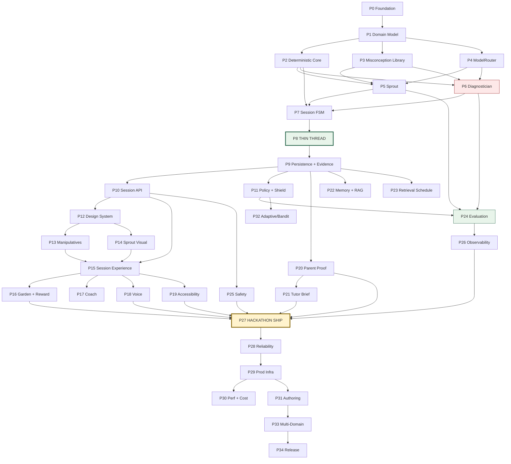
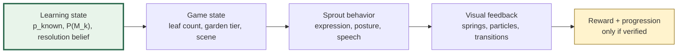
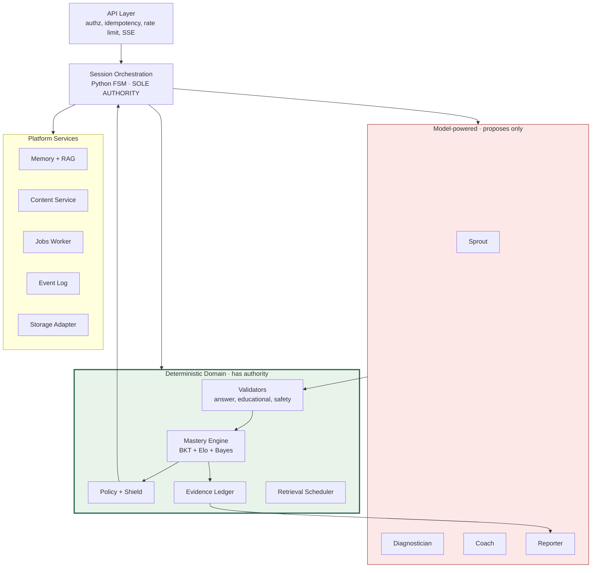
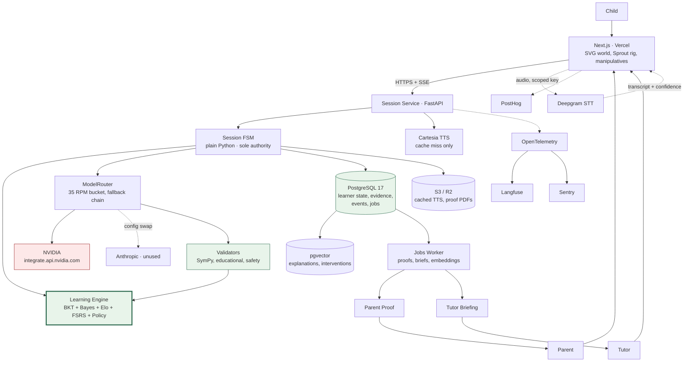

# PROTÉGÉ — MASTER IMPLEMENTATION ROADMAP
### v2.0 · Zero code → production platform · Sept 5, 2026
### Reconciles `PROTEGE_ARCHITECTURE.md` (v1.0) + `PROTEGE_ENGINEERING_ADDENDUM.md` (v1.1)

---

# PART 1 — RECONCILIATION

Both source documents were read in full. **The Addendum changes twelve engineering decisions and zero product decisions.** Everything about the learning design, the child experience, the evidence model, and the evaluation philosophy in v1.0 survives intact.

## 1.1 Contradictions, resolved explicitly

| # | Topic | v1.0 said | Addendum said | **RESOLUTION** |
|---|---|---|---|---|
| 1 | Session workflow engine | XState v5 in-process | XState is TypeScript, backend is Python — an error | **Plain Python FSM**: transition table + guard functions, persisted to `session_states`. XState permitted client-side for UI state only |
| 2 | LangGraph rationale | "LangGraph lets the LLM choose the path" | Inaccurate; LangGraph supports deterministic routing | **Still not adopted**, but for the correct reasons: small static graph, need for queryable audit rows, latency, dependency cost. Revisit on durable multi-day interrupts or a genuinely dynamic tool-selecting agent |
| 3 | Runtime models | Sonnet 5 / Opus 5 / Haiku 4.5 | NVIDIA-hosted open models | **NVIDIA is the runtime provider.** Anthropic adapter retained behind `LLMProvider` as a config-swap |
| 4 | SDK | Anthropic SDK | `openai` SDK with NVIDIA `base_url` | **`openai` SDK, base_url override.** `anthropic` SDK confined to `tools/authoring/` |
| 5 | Database | Aurora Serverless v2 | RDS `db.t4g.micro` + pgvector | **RDS t4g.micro** through Production V1; Aurora only under sustained load |
| 6 | Cache | ElastiCache Redis | In-process | **In-process** until a second container exists; then Redis |
| 7 | Async transport | EventBridge → SQS → worker | Postgres `events` + `jobs` | **Postgres tables.** *Event schema from v1.0 §24 unchanged* — transport changed, model preserved |
| 8 | Realtime transport | WSS via ALB | HTTP + SSE; browser→Deepgram direct | **SSE + direct browser STT** for hackathon; server-attested audio path in production |
| 9 | Moderation | Haiku 4.5 per turn | Local classifier | **Local classifier + blocklist**, to protect the 40 RPM budget |
| 10 | Embeddings | `text-embedding-3-small` | local `bge-small` or NVIDIA | **Local `bge-small`** (free, ~10 embeds/session) |
| 11 | Registry | ECR | ghcr.io | **ghcr.io** |
| 12 | Cost/session | $0.196 | ~$0.01 | **~$0.01 actual**; v1.0 frontier-model model retained as an appendix for the "how does this scale on paid models" question |

## 1.2 Carried forward untouched (do not re-litigate)

Teach-back window (0.35–0.80) · teaching-expectancy tease at 0:20 · transfer as a *separate claim*, never erasing mastery · the eight child-facing words · the internal→child translation table · `mastery_effective = P(L)·Π(1−P(M_k))` · BKT + Elo + authored `P(d|M_k)` Bayes · 3× weight on unaided verification · hint-discount 0.4 · the 20 non-negotiable principles · the 7 hallucination classes · the provenance chain · the 10 evaluation surfaces and their gates · time-matched experiment design · the 480-expression Sprout rig · garden progression · reward eligibility rule · 25-minute hard cap · termination priority order · RBAC and retention · the two RAG use cases and only those · recursive-CTE skill graph · content validators · RL gates and trajectory schema · the Fable $100 allocation.

## 1.3 The four scope bands used throughout

| Band | Meaning | Phases |
|---|---|---|
| **A — Thin Thread** | Smallest build that proves the concept end to end | P0–P8 |
| **B — Hackathon** | What ships Sept 18 | P9–P27 |
| **C — Production V1** | What a real company launches | P28–P32 |
| **D — Platform** | Multi-domain, multi-year | P33–P34 |

---

# PART 2 — THE PHASES

Every phase uses the same fourteen fields. Where a field genuinely does not apply, it says so rather than inventing work.

---

## ERA A — CORE ENGINE (Band A)
*Goal: prove Learn → Teach → Prove works, in a terminal, before a single pixel exists.*

### P0 — REPOSITORY & DEVELOPMENT FOUNDATION

**Purpose.** Make every later phase cheap. A repo where tests, evals, and previews run on every commit is the difference between a 13-day sprint and a 13-day scramble.
**Unlocks.** Any parallel work at all.
**Components.** Monorepo (`apps/web`, `services/session`, `packages/contracts`, `content/`, `evals/`, `tools/authoring/`, `infra/`); `uv` or Poetry; Ruff + mypy strict; Prettier + ESLint; pre-commit; GitHub Actions; `.env.example`; `docker-compose.yml` (Postgres 17 + pgvector, Langfuse); `Makefile` with `make dev`, `make test`, `make eval`.
**Depends on.** Nothing.
**Frontend.** Next.js 15 + React 19 + TypeScript scaffold, Vercel project linked, preview-per-PR verified with a hello page. No product UI.
**Backend.** FastAPI skeleton, `/healthz`, structured JSON logging, settings via Pydantic `BaseSettings`.
**Learning engine.** None.
**AI.** `.env` slots for `NVIDIA_API_KEY`, `DEEPGRAM_API_KEY`, `CARTESIA_API_KEY`, `ANTHROPIC_API_KEY` (authoring only). **Day-0 action: create the NVIDIA account and request the credit increase immediately — it is not instant.**
**Data.** Alembic initialised, empty baseline migration.
**Infra.** Local Docker only. `ghcr.io` package created. GitHub OIDC role stub for later AWS use.
**Testing.** One trivial unit test and one trivial Playwright test, both green in CI, proving the harness works.
**Observability.** OTel SDK installed and emitting to console; Langfuse container up.
**User-visible.** Nothing.
**Exit criteria.** A PR produces a Vercel preview URL and a green CI run in under 5 minutes. `make dev` brings up the full local stack from a clean clone.

---

### P1 — DOMAIN MODEL & CONTENT SCHEMA

**Purpose.** Define the vocabulary of the system once, in one place, so frontend, backend, content, and evals cannot drift.
**Unlocks.** Every other phase; content authoring can start in parallel.
**Components.** `packages/contracts` — Pydantic models with generated TypeScript types and JSON Schema. Entities: `Skill`, `Concept`, `Prerequisite`, `Misconception`, `LearningItem`, `ItemVersion`, `Distractor`, `Intervention`, `SproutScript`, `TransferItem`, `Evidence`, `MasteryEstimate`, `MisconceptionBelief`, `TeachingEpisode`, `Diagnosis`, `Explanation`, `PolicyDecision`, `ProofClaim`, `TutorBriefing`, `DomainEvent`.
**Depends on.** P0.
**Frontend.** Generated TS types consumed by a typed API client stub. No UI.
**Backend.** Contracts package importable by the service; a `make types` step regenerates TS from Pydantic and fails CI on drift.
**Learning engine.** Defines the *shape* of mastery and misconception state, not the math.
**AI.** Defines the structured-output schemas the ModelRouter will enforce — `SproutTurn`, `DiagnosisResult`, `CoachHint`, `ReportDraft`.
**Data.** No tables yet; schemas only. `content/schema/*.json` published for authoring.
**Infra.** None.
**Testing.** Round-trip serialisation tests; a schema-snapshot test that fails loudly on any breaking change.
**Observability.** None.
**User-visible.** Nothing.
**Exit criteria.** The worked example from v1.0 §38 (skill S004 → M003 → Sprout scripts → item → evidence → mastery outcome) validates cleanly against the schemas as a single JSON document.

---

### P2 — DETERMINISTIC CORE

**Purpose.** Build the part of the system that has authority, before building the part that only proposes. This ordering is deliberate and is the spine of the architecture.
**Unlocks.** Everything downstream can now be validated rather than trusted.
**Components.** `answer_validator` (exact rational arithmetic via SymPy/`Fraction`, representation-aware); `mastery_engine` (BKT + Elo + misconception Bayes); `educational_validator` (answer-leak, reading level, misconception consistency, schema); `threshold_service` (mastery decision rules); `evidence_builder`.
**Depends on.** P1.
**Frontend.** None.
**Backend.** Pure functions, no I/O, no framework coupling — importable by tests, the service, and the eval harness alike.
**Learning engine.** The BKT update from v1.0 §10.2; `P(M_k|d) ∝ P(d|M_k)·P(M_k)` with authored likelihoods; Elo item difficulty with online update; `mastery_effective = P(L)·Π(1−P(M_k))`; hint discount 0.4; verification weight 3×; the mastery threshold `P(L) ≥ 0.85 AND ≥3 unaided correct AND ≥1 transfer attempted`, with `transfer_verified` recorded **separately**.
**AI.** **None. Zero LLM calls in this phase — that is the point.**
**Data.** None yet.
**Infra.** None.
**Testing.** 200+ unit tests. Property tests: mastery is monotone in correct responses; a resolved misconception never re-raises without new evidence; `p_known` stays in [0,1]; the answer validator accepts every equivalent form of a correct fraction and rejects every near-miss.
**Observability.** Every mastery update emits a structured decision record for later tracing.
**User-visible.** Nothing.
**Exit criteria.** A synthetic learner with a planted misconception, driven through 20 scripted responses, produces a mastery trajectory a human can read and agree with. No LLM has been called yet.

---

### P3 — MISCONCEPTION LIBRARY & ITEM BANK

**Purpose.** This is the intellectual property. Eight deeply authored misconceptions are worth more than eight thousand generated items.
**Unlocks.** Sprout, the Diagnostician, the item bank, the golden sets — all of them are downstream of this content.
**Components.** 8 fraction misconceptions, each with: title, description, cognitive origin, `distractor_likelihood` table, prevalence prior, citation, 6 Sprout candidate utterances, `sprout_forbidden` list, 3 interventions, 4 diagnostic items, 2 transfer items. Plus 40 practice items and 8 transfer items across two representations.
**Depends on.** P1 (schema). **Runs in parallel with P2** — different owner, no code dependency.
**Frontend.** None.
**Backend.** Content loader; content is versioned files in `content/math/fractions/v1/`, loaded into memory and later into Postgres.
**Learning engine.** Supplies the authored `P(d|M_k)` tables the Bayes update needs — **the highest-leverage half-day in the whole build.**
**AI.** **Fable 5.1, batch mode, offline — $30 of the budget.** Then human review of every record. Fable drafts; a human ratifies. Nothing enters the library unreviewed.
**Data.** JSON files under version control, validated against P1 schemas in CI.
**Infra.** None.
**Testing.** Every item passes the P2 validator. Every distractor maps to a real misconception code. Every Sprout script is checked for answer leakage *at authoring time*. Reading level ≤ Grade 3.5 on all child-facing text.
**Observability.** None.
**User-visible.** Nothing yet — but this file is what the child will actually experience.
**Exit criteria.** 8 misconceptions and 40+ items validate clean; a domain-literate human has signed off on each cognitive-origin explanation; the v1.0 §38 worked example is one of them.

---

### P4 — PROVIDER LAYER & MODELROUTER

**Purpose.** Make the model a swappable detail before any code depends on a specific one.
**Unlocks.** Sprout, Diagnostician, Coach, Reporter.
**Components.** `LLMProvider` protocol; `NvidiaProvider` (openai SDK, `base_url=https://integrate.api.nvidia.com/v1`); `AnthropicProvider` (config-swap, unused at runtime); `FakeProvider` (canned responses for tests); `ModelRouter` with `ROLE_POLICY`, fallback chains, **35 RPM global token bucket**, circuit breaker, prompt-hash response cache, and per-call telemetry.
**Depends on.** P1.
**Frontend.** None.
**Backend.** `protege/llm/` package. Startup health check pings every model in `ROLE_POLICY` and **refuses to boot** on failure.
**Learning engine.** None.
**AI.** Three-tier structured output: native `response_format: json_schema` → JSON-mode prompt + Pydantic + one repair → deterministic fallback. **Detect per-model capability once at startup and cache it** — NIM support varies by model.
**Data.** `model_runs` schema defined: provider, endpoint, model_id, role, prompt_version, attempt_index, fallback_reason, structured_mode, tokens, latency, trace_id.
**Infra.** None. Secrets from env locally.
**Testing.** `FakeProvider` powers all downstream unit tests. Rate-limiter property test: never exceeds 35 RPM under concurrent load. Fallback-chain tests simulating 429, timeout, 5xx, malformed JSON.
**Observability.** Every call emits a Langfuse span tagged `pedagogical_role` — so "what does diagnosis cost per session" is answerable from day one.
**User-visible.** Nothing.
**Exit criteria.** A round-trip call to a real NVIDIA model returns a schema-valid object; killing the primary model in config transparently falls through to secondary and then to the deterministic fallback, with each hop logged.

---

### P5 — SPROUT GENERATOR

**Purpose.** A controlled simulated learner that can never make an educationally invalid mistake.
**Unlocks.** The teach-back loop.
**Components.** `SproutState` object; behaviour-constraint compiler (misconception record → prompt constraints); candidate-pool selector; generation call; the four-stage validation gate; authored fallback emitter.
**Depends on.** P3 (content), P4 (router), P2 (educational validator).
**Frontend.** None.
**Backend.** `protege/roles/sprout.py`. The correct answer is **withheld from Sprout's context entirely** — prevention before detection.
**Learning engine.** Consumes a `misconception_id` chosen by code; never chooses one itself.
**AI.** Prompt versioned in `prompts/sprout/vN.md`. Temp 0.7. Max 30 words. Emotion enum driven by resolution belief, never by sentiment.
**Data.** `sprout_profiles`, `sprout_scripts` loaded from content.
**Infra.** None.
**Testing.** **Fidelity harness: 200 generations per misconception.** Gate: mean fidelity ≥ 0.90, `answer_leak_rate` = **0.000** (deterministic substring + numeric-equivalence check, not an LLM judge).
**Observability.** `sprout_fidelity`, `answer_leak_rate`, `fallback_rate` as first-class metrics.
**User-visible.** Nothing yet.
**Exit criteria.** Both gates met on the real NVIDIA model. Forcing two validator failures produces an authored line indistinguishable in quality from a generated one.

---

### P6 — DIAGNOSTICIAN

**Purpose.** Infer the *child's* knowledge state from how they teach. This is the one genuinely hard inference in the system.
**Unlocks.** Evidence, mastery updates, the whole "it understands the learner" claim.
**Components.** Closed-set classifier; abstention logic; evidence-span extraction; confidence calibration; rule-based fallback (distractor → misconception map).
**Depends on.** P3, P4, P2.
**Frontend.** None.
**Backend.** `protege/roles/diagnostician.py`. Output is **strictly** `{labels:[{misconception_id, state, confidence, evidence_span}], understanding_signals:[enum], asr_reliable: bool}` over a closed set.
**Learning engine.** Feeds `misconception_beliefs` via Bayes; never writes mastery directly.
**AI.** Largest reasoning-capable NVIDIA model. Few-shot examples per misconception. **Must abstain when `mean_asr_confidence < 0.65`** rather than guess.
**Data.** `diagnoses` table schema; 120-item hand-labelled golden set (**Fable, $25**, then human ratification).
**Infra.** None.
**Testing.** **Macro-F1 ≥ 0.75 · ECE ≤ 0.10 · Brier ≤ 0.18** on the golden set. Ablation: measure the rule-based fallback alone, so you know exactly what the LLM is buying you.
**Observability.** F1 on a shadow set, abstention rate, per-label confusion matrix.
**User-visible.** Nothing yet.
**Exit criteria.** **The F1 gate is met on the actual open model.** This is the single most load-bearing number in the project — if it misses, fix the prompt and few-shots before anything else proceeds.

---

### P7 — SESSION FSM & ORCHESTRATOR

**Purpose.** Give the system a spine that no model can move.
**Unlocks.** A real session.
**Components.** `S` StrEnum of 21 states; `TRANSITIONS: dict[(state, event) → [Transition(to, guard)]]`; ordered-guard evaluation; `step()`; timeout handler; `IllegalTransition`; in-memory session context; transition journal.
**Depends on.** P2, P5, P6.
**Frontend.** None.
**Backend.** `protege/session/machine.py` + `orchestrator.py`. **Plain Python — no XState, no LangGraph.** Every transition appended to a journal that will become `session_states`.
**Learning engine.** READINESS choice node implements the 0.35 / 0.80 window with loop counting; escalation at 3 loops.
**AI.** The orchestrator *calls* roles; roles never call the orchestrator. Any model output resembling a routing instruction is ignored.
**Data.** Journal in memory this phase; persisted in P9.
**Infra.** None.
**Testing.** **Golden traces:** 20 scripted sessions replayed with assertion of identical state sequences. Property test: `TEACH_BACK` is unreachable when `p_known < 0.35`. Every state has a timeout path and a failure path.
**Observability.** One OTel span per state; dwell time per state.
**User-visible.** Nothing yet.
**Exit criteria.** All 21 states reachable in tests; illegal transitions raise; golden traces deterministic across 10 runs.

---

### P8 — ★ THE THIN THREAD (VERTICAL SLICE)

**Purpose.** Prove Learn → Teach → Prove works, end to end, before investing in anything else. **If this fails, you need to know now.**
**Unlocks.** Confidence. Everything after this is UI, persistence, and instrumentation over a proven thread.
**Components.** One skill (S004), one misconception (M003), 6 hardcoded items, terminal I/O. No auth, no DB, no UI, no deploy.
**Depends on.** P2–P7.
**Frontend.** **None — explicitly.** No landing page, no dashboard, no game world.
**Backend.** A single `python -m protege.thin_thread` entry point wiring FSM → Sprout → Diagnostician → mastery → verification.
**Learning engine.** BKT live; misconception belief live; verification weighted; claim emitted with evidence IDs.
**AI.** Sprout + Diagnostician on NVIDIA, with fallbacks armed.
**Data.** JSON file in, evidence list out.
**Infra.** Local only.
**Testing.** The transcript in v1.0 §42 reproduces.
**Observability.** Console trace showing every state, every model call, every validator result.
**User-visible.** A developer can play a full session in a terminal and watch mastery move for defensible reasons.
**Exit criteria.** The §42 transcript runs start to finish, with a claim backed by five evidence IDs. **Target: end of Day 2 of the build.**

---

## ERA B — SERVICE LAYER (Band B)

### P9 — PERSISTENCE, EVIDENCE LEDGER, EVENTS & JOBS

**Purpose.** Make learning durable, auditable, and reconstructible.
**Unlocks.** Multi-session learners, parent proof, tutor brief, the RL substrate.
**Components.** Full schema from v1.0 §22; the **`events`** table (fan-out facts, append-only, RL substrate); the **`jobs`** table (one consumer, must complete, `SELECT … FOR UPDATE SKIP LOCKED`); worker loop; `StorageAdapter` (local FS ↔ S3/R2).
**Depends on.** P1, P8.
**Frontend.** None.
**Backend.** SQLAlchemy 2 + asyncpg; Alembic migrations; repository pattern per aggregate. **Queue and bus semantics kept conceptually separate even though both live in Postgres.**
**Learning engine.** `mastery_estimates` and `misconception_beliefs` become authoritative persisted state; `evidence` rows carry `source_event_id` and `weight`.
**AI.** `model_runs` persisted per call.
**Data.** All tables from §22 including `policy_decisions` with `state_vector vector(14)`, and `embedding_records` with an HNSW index. pgvector extension enabled.
**Infra.** Local Postgres 17 + pgvector via Docker.
**Testing.** Migration up/down round trip; cascade-delete test proving a learner deletion removes memory and embeddings; append-only enforcement on `evidence` and `safety_events`; job retry and failure-status test.
**Observability.** DB query timing; job queue depth and age.
**User-visible.** Nothing directly — but every claim is now traceable.
**Exit criteria.** A completed session persists and fully rehydrates. Any claim resolves to its evidence tree by query. Deleting a learner leaves no orphaned vectors.

---

### P10 — SESSION SERVICE API

**Purpose.** Expose the FSM over HTTP without letting the client become authoritative.
**Unlocks.** The frontend.
**Components.** The v1.0 §23 endpoints, amended per the Addendum: `POST /v1/sessions`, `GET /v1/sessions/{id}`, **`POST /v1/sessions/{id}/events`** (the main verb), `GET /v1/sessions/{id}/stream` (**SSE**), `POST /v1/sessions/{id}/complete`, `GET /v1/learners/{id}/state`, `/proof/{id}`, `/tutor-brief`, `POST /v1/parents/{id}/deletion-request`. **No WebSocket endpoint** — see P18.
**Depends on.** P9.
**Frontend.** Generated typed client from OpenAPI.
**Backend.** Clerk JWT verification with server-side ownership checks; `Idempotency-Key` with 24 h dedupe (Postgres at this scale); RFC 9457 errors carrying a `child_safe_message` the UI renders directly; rate limits 60 events/min/learner, 10 sessions/day.
**Learning engine.** Unchanged — the API is a transport over P7.
**AI.** Sprout tokens stream over SSE; diagnosis returns whole or fails.
**Data.** Request/response logging with PII redaction.
**Infra.** Local uvicorn.
**Testing.** Contract tests against OpenAPI; idempotency test (same key twice → one state change); authz matrix test (parent/child/tutor/admin × resource).
**Observability.** One trace per request, propagated to the client via `traceparent`.
**User-visible.** Nothing yet.
**Exit criteria.** The Thin Thread replays entirely over HTTP with identical outcomes. A refresh mid-session rehydrates to the exact state.

---

### P11 — POLICY ENGINE, SHIELD & TRAJECTORY LOG

**Purpose.** Choose the next learning action defensibly, and log everything a future policy would need.
**Unlocks.** Adaptive pacing now; RL later.
**Components.** 14-dim context vector; 13-action set; **rules + deterministic safety shield**; counterfactual logging; reward definition with delayed components.
**Depends on.** P2, P9.
**Frontend.** None.
**Backend.** `protege/policy/`. The shield **unconditionally overrides**: no TEACH_BACK below 0.35; no DIFFICULTY_UP after 2 consecutive errors; no withheld HINT past 90 s of struggle; HUMAN_TUTOR on 3 loops or distress; never exceed 25 minutes.
**Learning engine.** Item selection by Elo match targeting ~0.75 success.
**AI.** **None — zero LLM.** This is deliberate and is worth saying in the demo.
**Data.** `policy_decisions` rows with state vector, chosen action, source (`rules`), `shield_overrode`, and `counterfactual_bandit_choice`.
**Infra.** None.
**Testing.** Property tests on every shield rule. Regret measurement against an oracle over simulated learners (needs P24).
**Observability.** Action distribution; shield-override rate; hint-rate trend.
**User-visible.** Sessions now pace themselves to the child.
**Exit criteria.** Shield provably unbypassable by property test. Every decision produces a complete, replayable trajectory row. **Reward function contains `+0·time_on_task` explicitly.**

---

## ERA C — THE EXPERIENCE (Band B)
*This era is the product. It gets the most phases because it deserves them.*

### P12 — DESIGN SYSTEM & APP SHELL

**Purpose.** Establish the world's visual language before building screens, so nothing looks assembled.
**Unlocks.** Every screen.
**Components.** Tokens (a warm palette — moss, sand, sky, apricot; **never red for wrong**); type scale with a rounded, high-x-height face; spacing; radii; motion primitives (spring presets: `settle`, `pop`, `wobble`, `drift`); sound tokens (soft, optional, off by default); the app shell with route groups `(child)`, `(parent)`, `(tutor)`.
**Depends on.** P0, P10.
**Frontend.** Tailwind config from tokens; `Motion` spring presets; a Storybook-equivalent gallery route; layout primitives; a single `SceneFrame` that all child screens render inside so transitions are continuous rather than page-swaps.
**Backend.** None.
**Learning engine.** None.
**AI.** None.
**Data.** None.
**Infra.** None.
**Testing.** Visual snapshots; reduced-motion honoured; contrast ratios ≥ 4.5:1 verified in CI via axe.
**Observability.** PostHog page/scene instrumentation.
**User-visible.** A warm, coherent shell. Even empty, it should not feel like a developer demo.
**Exit criteria.** Three sample scenes cross-fade without layout jump; a designer-neutral observer describes the palette as "calm and friendly," not "corporate."

---

### P13 — MANIPULATIVES & INTERACTION PRIMITIVES

**Purpose.** Give the child something to *think with*, not just answer into. The manipulative is also the non-verbal teach-back channel — the safety net that makes the whole thesis robust.
**Unlocks.** Discovery, guided learning, practice, teach-back modality (c), transfer.
**Components.** `FractionBar` (partition, drag, align, compare); `NumberLine` (snap, place, compare); `AreaModel` (pie/rect arcs); `ExplanationCards` (3-choice non-verbal explanation); shared `ManipulativeTrace` emitter.
**Depends on.** P12.
**Frontend.** SVG + Motion, **no canvas engine**. Magnetic snapping with hysteresis; 60 fps springs; pointer + touch + **keyboard** control; every manipulative emits a structured interaction trace `{t, action, target(s)}` that becomes diagnostic evidence.
**Backend.** `manipulative_moved` event accepted on the events endpoint.
**Learning engine.** The trace is a **first-class diagnostic input**, equal in standing to speech — a child who aligns 1/4 and 1/8 correctly has demonstrated understanding without a word.
**AI.** Trace is serialised into the Diagnostician's context.
**Data.** Traces stored on `turns`.
**Infra.** None.
**Testing.** Interaction tests for drag/snap/align; keyboard-only completion of every manipulative; trace-shape contract tests.
**Observability.** Time-to-first-interaction; abandonment within a manipulative.
**User-visible.** **The child can now touch the maths.** Dragging two fraction bars into alignment and seeing 1/8 sit visibly inside 1/4 is the concept, physically.
**Exit criteria.** Every manipulative is completable by mouse, touch, and keyboard; traces reconstruct the child's actions faithfully.

---

### P14 — SPROUT VISUAL SYSTEM

**Purpose.** Make Sprout feel alive, and make that aliveness *mean something*.
**Unlocks.** Teach-back as an emotional experience rather than a chat log.
**Components.** The combinatorial rig — 5 eyes × 6 mouths × 4 brows × 4 poses = 480 expressions from ~19 SVG paths; leaf counter (0–5); 3 particle emitters; speech bubble with typewriter reveal timed to TTS; entrance/exit choreography.
**Depends on.** P12.
**Frontend.** Layered SVG with independently driven parts, interpolated by springs. Idle life: blink on a Poisson timer, breathing sway, occasional look-at-cursor. **Emotion state comes from the Diagnostician's resolution belief, never from sentiment analysis.**
**Backend.** Sprout emotion enum included in the turn payload.
**Learning engine.** `confused → thinking → dawning → delighted` maps to resolution belief crossing thresholds. **Sprout is never delighted before the misconception clears.** This is the "game state follows learning state" principle made visible.
**AI.** Utterance from P5; emotion from P6.
**Data.** None new.
**Infra.** SVG assets in the repo; no external asset pipeline.
**Testing.** All 480 combinations render without clipping; expression-state snapshot tests; a "Sprout mood must equal belief state" assertion in E2E.
**Observability.** None specific.
**User-visible.** **A character children will talk to.** The moment Sprout's face shifts from confused to dawning because of something the child said is the product.
**Exit criteria.** Sprout reads as expressive to a real child; no expression contradicts learning state under any transition.

---

### P15 — SESSION EXPERIENCE ASSEMBLY

**Purpose.** Turn 21 backend states into one continuous world with no seams.
**Unlocks.** A playable session.
**Components.** Screens 2–16 from v1.0 §37: garden home, Sprout tease, diagnostic, discovery, guided learning, practice, explanation capture, Sprout entrance, teach-back, recovery, reflection, independent verify, transfer, reward, summary.
**Depends on.** P10, P12, P13, P14.
**Frontend.** A `SessionMachine` **client mirror** (XState is permitted *here* only) that reflects server state and drives scene transitions — it never decides transitions. Scene continuity: the garden persists behind every scene; screens slide and dissolve rather than navigate. Pacing: deliberate beats, no instant jumps; the child always sees *why* something changed. **The eight-word vocabulary is enforced by a lint rule on user-facing strings.**
**Backend.** SSE stream drives scene changes and token streaming.
**Learning engine.** The evidence sidebar (developer/demo mode) renders evidence as it is captured — the "wait, it understands the learner" moment.
**AI.** Streaming Sprout utterances; Coach hints on request.
**Data.** Session rehydration on refresh.
**Infra.** None.
**Testing.** Playwright E2E of the full happy path; misconception-recovery path; escalation path. **A "no forbidden vocabulary" test** scanning rendered text for percentages, "AI", "mastery", "model".
**Observability.** Per-scene dwell time; drop-off by scene.
**User-visible.** **A child can play a complete session end to end and it feels like one place, not eighteen screens.**
**Exit criteria.** A 9-year-old completes a session unaided with no adult explanation of the UI. No scene transition feels abrupt or unexplained.

---

### P16 — GARDEN, REWARD & PROGRESSION

**Purpose.** Give effort a visible, honest consequence — without inventing a currency.
**Unlocks.** Return motivation; long-horizon meaning.
**Components.** Parallax garden (4 SVG layers); sky-gradient time-of-day tied to session count; plant growth tied to resolved misconceptions; area unlock at cluster mastery; "Sprout learns a new word"; achievement card rendering the evidence tree.
**Depends on.** P12, P14, P9.
**Frontend.** 6 mastery levels × 3 times of day = 18 distinct scenes from one asset set. Kenney.nl **CC0** props. Leaf-unfurl reward: 1.2 s, particle burst, once, never repeated for the same achievement.
**Backend.** `REWARD_GRANTED` event; reward eligibility computed server-side.
**Learning engine.** **`reward_eligible = mastery_delta > 0 AND unaided_verification_passed`** — enforced in deterministic code. A leaf cannot be earned by clicking.
**AI.** "Sprout's new word" is sourced from a **real logged child explanation**, never generated.
**Data.** `garden_state` derived from mastery, not stored independently — so it can never drift from truth.
**Infra.** None.
**Testing.** Property test: no reward without verified mastery. Replay a session with verification failed → no leaf.
**Observability.** Rewards granted vs. mastery events (must be 1:1).
**User-visible.** **"I taught Sprout and his plant grew."** Causality the child can see.
**Exit criteria.** No XP, coins, badges, or leaderboards exist anywhere in the codebase. Every reward traces to a mastery event.

---

### P17 — COACH & SCAFFOLDING EXPERIENCE

**Purpose.** Help a stuck child without teaching them to wait for help.
**Unlocks.** Recovery paths; reduced frustration exits.
**Components.** Intervention selector (authored library); Coach personalisation call; hint-cost surfacing; struggle detection.
**Depends on.** P3, P4, P11.
**Frontend.** Hint button present in practice, **visibly absent in verification** — the child should *see* that this one counts. Hints arrive as Sprout speech or a manipulative demonstration, never a wall of text.
**Backend.** `hint_requested` event; hint attribution recorded on the response.
**Learning engine.** Hint dependency counter; 0.4 evidence discount; policy shield forces a hint after 90 s of visible struggle.
**AI.** Coach **rewrites an authored intervention**; it never invents pedagogy. `unauthored_hint_rate` must be 0.
**Data.** `interventions` with `historical_success_rate` updated from outcomes.
**Infra.** None.
**Testing.** Assert every delivered hint maps to an authored `intervention_id`.
**Observability.** Hint rate by state; intervention success rate.
**User-visible.** Help that feels like a friend nudging, not a system giving up on you.
**Exit criteria.** Zero unauthored hints across 500 generations; hint dependency visibly discounts evidence in the mastery trace.

---

### P18 — VOICE

**Purpose.** Let young children teach out loud, which is how children naturally explain.
**Unlocks.** The most natural teach-back modality.
**Components.** Browser VAD; **browser→Deepgram streaming with short-lived scoped keys**; confidence-aware repair; TTS with S3/R2 pre-render cache; barge-in.
**Depends on.** P15, P10.
**Frontend.** Push-to-talk **and** VAD modes; waveform feedback; barge-in stops playback within 120 ms; **automatic promotion of the manipulative + cards path after 2 low-confidence turns.**
**Backend.** Short-lived Deepgram key minting endpoint; transcript + word confidences arrive as a normal `explanation_given` event. **No WebSocket endpoint** — SSE only. Production migration to server-attested audio changes only who calls Deepgram.
**Learning engine.** `asr_reliable` gates diagnosis; low confidence → abstain → in-character clarifying question.
**AI.** Cartesia TTS; **all authored lines pre-rendered once to object storage** — near-instant playback and near-zero cost.
**Data.** Audio never persisted server-side in the hackathon path; transcripts + confidence stored. 24 h deletion rule applies to any audio that is stored in production.
**Infra.** `StorageAdapter` serves cached audio.
**Testing.** Real child audio samples; barge-in latency; **a mute-child E2E test proving full completion with zero voice.**
**Observability.** ASR confidence distribution; repair rate; TTS cache hit rate; voice turn p95.
**User-visible.** **The child talks to Sprout and Sprout answers.** ASR failure surfaces as Sprout asking them to say it again — pedagogically valid, never an error.
**Exit criteria.** Voice turn p95 ≤ 2.0 s. **Voice is fully removable via a feature flag without breaking any path.** (This is the first thing cut if the latency gate misses.)

---

### P19 — ACCESSIBILITY & RESILIENT STATES

**Purpose.** A child who cannot speak, cannot hear, cannot use a mouse, or has a flaky connection still learns.
**Unlocks.** Real usability; a genuine differentiator most hackathon entries skip entirely.
**Components.** Keyboard navigation for every interaction; screen-reader labels for manipulatives; captions for all Sprout speech; reduced-motion mode; dyslexia-friendly font toggle; loading, empty, error, offline, and degraded states.
**Depends on.** P13, P15, P18.
**Frontend.** **Every error state is in-character** — never a stack trace, never a red banner. Offline: buffer up to 20 events, current item fully local, gentle pause card after ~60 s. Loading: Sprout thinks rather than a spinner.
**Backend.** `child_safe_message` on every error response.
**Learning engine.** None.
**AI.** Degraded mode indicator drives Sprout's in-character explanation ("I need a snack").
**Data.** Client-side event buffer with replay on reconnect.
**Infra.** None.
**Testing.** axe-core in CI; keyboard-only full session; screen-reader walkthrough; **network-chaos E2E** dropping the connection mid teach-back.
**Observability.** Degraded-mode frequency; offline buffer flush success.
**User-visible.** The product never breaks character, even when it is broken.
**Exit criteria.** Zero axe violations; a full session completed keyboard-only and voice-free; a mid-session network drop recovers without data loss.

---

### P20 — PARENT PROOF EXPERIENCE

**Purpose.** The commercial artifact. Credibility comes from stating what it does **not** know.
**Unlocks.** Parent trust; the "why would anyone pay" answer.
**Components.** Proof card; **clickable evidence tree**; mandatory uncertainty block; one 2-minute tonight action; consent and controls; data export; deletion.
**Depends on.** P9, P4.
**Frontend.** No scores, no percentages, no grades. Every claim expands to its evidence tree — this expansion is the most persuasive five seconds in the demo. Controls: voice retention (default delete in 24 h), **model-training opt-in default OFF**, pause, tutor-share, export, delete.
**Backend.** Reporter role; async job on `SESSION_COMPLETED`; claim templates are **enum-selected, not free-written**.
**Learning engine.** Claims bound to thresholds; `transfer_verified` surfaced separately; the "not yet confirmed" block is **mandatory and never empty**.
**AI.** Reporter writes prose only from a fixed evidence bundle; **every sentence carries an `evidence_id` or is dropped.**
**Data.** `proof_artifacts` with claims, evidence IDs, caveats.
**Infra.** PDF rendered to object storage; signed URLs.
**Testing.** `ungrounded_sentence_rate` = 0; `overclaim_rate` = 0; a test asserting the uncertainty block is never empty.
**Observability.** Proof open rate; evidence-tree expansion rate.
**User-visible.** **A parent can see what was learned, how it was verified, what remains unknown, and what to do tonight.**
**Exit criteria.** Every sentence in every generated card resolves to a real evidence row. Attempting to generate a card with no evidence fails closed.

---

### P21 — TUTOR BRIEFING EXPERIENCE

**Purpose.** The strategic hook — eliminate the human tutor's cold start.
**Unlocks.** The Live+AI argument; the clearest production integration story.
**Components.** Briefing view at `/tutor/{learner_id}` behind a time-boxed grant; the v1.0 §30 format; JSON contract published as the real deliverable.
**Depends on.** P9, P20.
**Frontend.** Opens with **what not to re-teach** — the most valuable 20 seconds of tutor prep. Separates "assessed and open" from "never assessed." Evidence links throughout.
**Backend.** Time-boxed tutor grant, 7-day expiry, **every read written to `audit_events`**.
**Learning engine.** Successful-intervention history; effort/struggle indicators distinguishing tiring from stuck.
**AI.** Reporter, grounded, same zero-ungrounded-sentence rule.
**Data.** `tutor_briefings` with payload and `viewed_at`.
**Infra.** None.
**Testing.** Authz test: expired grant denies; every read audited.
**User-visible.** **A tutor arrives already knowing what happened and what to skip.**
**Exit criteria.** The JSON contract is clean enough that "rendering this in your console is an afternoon's work" is a true statement. No fabricated Nerdy API integration is claimed.

---

### P22 — MEMORY, RAG & PERSONALIZATION

**Purpose.** Let Protégé remember a child across sessions — carefully, and without letting memory corrupt truth.
**Unlocks.** Continuity; Sprout carrying the child's own analogy forward.
**Components.** Working (in-process) / episodic (Postgres) / semantic (pgvector) / structured state (authoritative) layers; embedding worker; hybrid retrieval.
**Depends on.** P9.
**Frontend.** Sprout references a prior session naturally ("last time you told me about pizza") — **only ever from a resolved `source_event_id`.**
**Backend.** Local `bge-small` embeddings; **two retrieval call sites only** — Diagnostician context (top-3 prior explanations, same learner + skill) and Coach (top-3 successful interventions). Relevance `0.6·cosine + 0.25·recency + 0.15·outcome_success`; hard metadata filters pre-search; no chunking; no reranker.
**Learning engine.** **Vectors never move a probability.** Structured state is derived only from validated responses.
**AI.** Memory claims validated by resolving `source_event_id`; unresolvable citation → sentence dropped.
**Data.** `memory_items`, `embedding_records` (HNSW), 18-month retention, 60-day recency half-life, contradictions retained not merged.
**Infra.** None new.
**Testing.** `unresolvable_citation_rate` = 0. A test proving a hallucinated memory cannot alter mastery.
**Observability.** Retrieval hit rate; degraded-retrieval frequency.
**User-visible.** Sprout remembers — accurately, and only what really happened.
**Exit criteria.** Retrieval improves diagnosis F1 measurably, or it is disabled. Deleting a learner removes every vector.

---

### P23 — RETRIEVAL SCHEDULING & RETURN LOOP

**Purpose.** Convert one good session into durable learning.
**Unlocks.** The 7-day retention metric; a reason to come back that is not a streak.
**Components.** FSRS-style scheduler; due-item surfacing; the return session opening with a retrieval check.
**Depends on.** P9, P2.
**Frontend.** A returning child is greeted by Sprout asking about something they taught him — **retrieval practice disguised as continuity**, not a "your streak is at risk" notification.
**Backend.** `retrieval_schedule` with `due_at`, `interval_days`, `stability`, `difficulty`.
**Learning engine.** Retention outcome feeds the delayed reward component and updates stability.
**AI.** None.
**Data.** `RETRIEVAL_SCHEDULED` event.
**Infra.** Scheduled job.
**Testing.** Interval-progression unit tests; a test asserting no streak or loss-aversion mechanic exists.
**Observability.** 7-day retention accuracy; return rate (**observed, never optimised**).
**User-visible.** Coming back feels like visiting a friend who remembers, not like feeding a streak.
**Exit criteria.** Delayed retention is measurable per skill per learner.

---

### P24 — EVALUATION HARNESS & SIMULATED LEARNERS

**Purpose.** Turn "our AI seems good" into numbers that gate deploys. **This is what separates the submission from the field.**
**Unlocks.** Every ship gate; the demo's credibility.
**Components.** Golden sets (120 diagnosis, 200 Sprout fidelity); **500 simulated learners with known ground-truth misconceptions**; eval runner in CI; disk cache keyed by prompt hash.
**Depends on.** P5, P6, P11.
**Frontend.** A metrics view for the demo showing real numbers.
**Backend.** `evals/` package runnable as `make eval`, results to Langfuse datasets.
**Learning engine.** Mastery MAE vs. held-out verification; AUC of `P(L)` predicting next-item correctness; policy regret vs. oracle over the simulated cohort.
**AI.** Sprout fidelity ≥ 0.90; leak = 0.000; diagnosis F1 ≥ 0.75; ECE ≤ 0.10; Brier ≤ 0.18; validator pass ≥ 0.99; fallback rate < 5%.
**Data.** Versioned eval datasets in the release manifest.
**Infra.** CI job; **eval results cached so a prompt tweak re-runs only changed cases** — essential given finite NVIDIA credits.
**Testing.** The evals *are* the tests at this tier.
**Observability.** Metric trends per release; regression alerts.
**User-visible.** Indirectly: quality that is verified rather than hoped for.
**Exit criteria.** **Every gate in v1.0 §26 has a real measured number**, and a failing gate blocks merge.

---

### P25 — SAFETY, PRIVACY & CHILD PROTECTION

**Purpose.** Make safety architectural, not a disclaimer.
**Unlocks.** The right to put this in front of a real child.
**Components.** The full v1.0 §16 pipeline; local moderation; distress detection; escalation path; consent ledger; retention automation; deletion.
**Depends on.** P10, P15.
**Frontend.** Escalation is **warm and in-character**: "Let's ask Ms. Rivera together." Parent notification. Never a scary modal.
**Backend.** Input validator → safety-in → state → retrieval → LLM → schema → educational validator → safety-out → deterministic check. **Child text never enters a system prompt** — delimited data block with an explicit ignore-instructions preamble. Sprout has no tools, so a successful injection can at worst produce one bad sentence, caught deterministically.
**Learning engine.** Distress and 3-loop failure force `HUMAN_TUTOR` via the shield.
**AI.** Local classifier + blocklist; fail closed.
**Data.** `safety_events` append-only, 36-month retention; audio 24 h; **training opt-in default OFF and recommended never enabled**; hard delete ≤ 30 days with tombstone.
**Infra.** Object-storage lifecycle rule enforcing 24 h audio deletion.
**Testing.** **300-case red-team suite** (Fable, $10): injection, off-topic, distress, personal-info probing. Gate: **0 violations**. Retention job test. Deletion cascade test.
**Observability.** Safety flags by type; escalations; injection attempts; moderation blocks. Alert on any high severity.
**User-visible.** A child who says something worrying gets a warm human handoff, not a canned refusal.
**Exit criteria.** Zero safety violations across the red-team suite; COPPA posture documented; deletion demonstrably complete.

---

### P26 — OBSERVABILITY & AI QUALITY

**Purpose.** Be able to answer "what happened and why" for any session, in under a minute.
**Unlocks.** Debugging, cost control, the engineering credibility of the demo.
**Components.** OTel throughout; Langfuse (LLM traces, prompt versions, datasets); Sentry; PostHog (analytics + flags); the six dashboards from v1.0 §25.
**Depends on.** P10, P24.
**Frontend.** PostHog instrumentation; Sentry with session replay; **a demo-mode evidence/telemetry sidebar.**
**Backend.** One `trace_id` propagated across all four tools so an engineer can pivot from a PostHog drop-off to the exact Langfuse generation that caused it.
**Learning engine.** Learning dashboard: mastery delta/session, verification pass %, transfer %, hint dependency, 7-day retention.
**AI.** AI-quality dashboard: fidelity, **answer-leak (must be 0)**, shadow F1, abstention, validator failures, fallback rate.
**Data.** `model_runs` powers cost-per-role reporting.
**Infra.** Langfuse self-hosted or cloud.
**Testing.** Trace-completeness test: every session produces one connected trace.
**Observability.** This phase *is* observability.
**User-visible.** Nothing directly.
**Exit criteria.** Any completed session is fully reconstructible from traces alone. Cost per pedagogical role is queryable.

---

### P27 — ★ HACKATHON MILESTONE: DEPLOY & DEMO

**Purpose.** Ship it, film it, submit it.
**Unlocks.** The submission.
**Components.** Deployment; seed data; demo script; README; architecture diagram; recorded demo; **a small real-child pilot (6–10 children)**.
**Depends on.** P9–P26.
**Frontend.** Vercel production; demo-safe seeded learner with two prior sessions.
**Backend.** One always-on container (Fargate or Fly.io); RDS `t4g.micro` + pgvector; S3/R2; ghcr.io image; secrets in Secrets Manager. **Not deployed: ALB, ElastiCache, SQS, EventBridge, CloudFront, Aurora.**
**Learning engine.** Pre-warmed caches on the demo path.
**AI.** Cached Sprout utterances and pre-rendered TTS along the demo route so latency is invisible. **Never demo with concurrent live users — 40 RPM is real.**
**Data.** Seeded misconception library, item bank, prior sessions.
**Infra.** Terraform applied; health checks; a rollback tag.
**Testing.** Full E2E on production URL; **chaos test killing the LLM provider mid-session, proving the session still completes.**
**Observability.** Live dashboards during the demo.
**User-visible.** **The complete hackathon product.**
**Exit criteria.** Demo recorded by noon Sept 18; **submitted by 4 PM CDT, not 11:59 PM.** Pilot results reported honestly as descriptive, n≈8, not causal.

---

## ERA D — RELIABILITY & PRODUCTION (Band C)

### P28 — RELIABILITY & GRACEFUL DEGRADATION

**Purpose.** Make every dependency except Postgres optional.
**Unlocks.** Trust under real conditions.
**Components.** The full v1.0 §33 degradation matrix; circuit breakers; retry policy; idempotency hardening; client event buffer.
**Depends on.** P27.
**Frontend.** All degraded modes expressed in character.
**Backend.** LLM down → authored lines + rule-based diagnosis. STT down → typing + manipulatives. TTS down → Sprout "loses his voice." Vector down → skip retrieval. Postgres down → **hard stop**, buffer client-side, replay on recovery.
**Learning engine.** Rule-based diagnosis fallback must still update beliefs correctly.
**AI.** Provider circuit breaker; overflow provider registered.
**Data.** Buffered-event replay with idempotency keys.
**Infra.** Health checks; automated restart.
**Testing.** A chaos suite killing each dependency in turn; assert session completion in every case except Postgres.
**Observability.** Degradation-mode frequency; time in degraded mode.
**User-visible.** The child rarely notices anything is wrong.
**Exit criteria.** Session completion ≥ 95% with any single non-Postgres dependency fully down.

---

### P29 — PRODUCTION INFRASTRUCTURE & SECURITY HARDENING

**Purpose.** Move from "deployed" to "operable."
**Unlocks.** Real users, real data, real obligations.
**Components.** Multi-container ECS/Fargate + ALB; **Redis** (now required for cross-container rate limiting and idempotency); server-attested voice path (audio through backend, WSS); Postgres RLS; Cognito migration path; backups and PITR; DR runbook.
**Depends on.** P28.
**Frontend.** No change beyond the voice transport swap.
**Backend.** In-process limiter → Redis; `jobs` → SQS **when volume or crash-safety demands**; `events` → EventBridge **when a fourth consumer appears** (schema unchanged either way).
**Learning engine.** No change.
**AI.** ModelRouter config can now point at Anthropic/Bedrock **as a one-file change** if quality or compliance requires it.
**Data.** RLS policies per `learner_id`; encrypted backups; restore drill.
**Infra.** Terraform for the full topology; canary deploys with auto-rollback; feature flags via PostHog.
**Testing.** Security test suite; penetration basics; authz matrix at scale; restore-from-backup drill.
**Observability.** Infra alarms in CloudWatch; SLO dashboards.
**User-visible.** Nothing — which is the point.
**Exit criteria.** A restore drill succeeds; a canary rollback succeeds; RLS proven to prevent cross-tenant reads.

---

### P30 — PERFORMANCE & COST ENGINEERING

**Purpose.** Keep the product fast and nearly free per session as usage grows.
**Unlocks.** Scale without a cost cliff.
**Components.** Latency budget enforcement; TTS pre-render coverage; prompt caching; response caching; model right-sizing; cost regression gates.
**Depends on.** P26, P29.
**Frontend.** Asset budgets; code splitting; prefetch of the next scene.
**Backend.** SLOs: UI interaction < 100 ms; API p95 < 300 ms; LLM first token < 600 ms; **voice turn p95 ≤ 1.3 s target, 2.0 s gate**; DB p95 < 50 ms.
**Learning engine.** No change.
**AI.** Push TTS cache hit toward 85%; cache Sprout utterances by `(misconception_id, turn_index, item_id)`; never route phrasing to the largest model.
**Data.** Cost per session by role, tracked per release.
**Infra.** 100 LLM calls/session hard ceiling; daily spend alarm; per-learner monthly cap; circuit breaker degrades to authored-only rather than overspending.
**Testing.** **CI fails if median session cost rises > 20%.** Load test at 50 concurrent sessions.
**Observability.** Cost and latency dashboards with per-release deltas.
**User-visible.** Speed.
**Exit criteria.** All SLOs met at 50 concurrent sessions; cost per session within target.

---

### P31 — CONTENT AUTHORING SYSTEM

**Purpose.** Let non-engineers extend the moat. Content velocity becomes the growth constraint the moment the platform works.
**Unlocks.** Scaling from 8 misconceptions to hundreds.
**Components.** Authoring UI; the v1.0 §15 validation pipeline; versioning; approval workflow; shadow deployment; rollback.
**Depends on.** P29.
**Frontend.** An internal authoring app: draft → validate → preview *as the child sees it* → submit for review.
**Backend.** Validation chain — schema → SymPy → skill alignment → difficulty → misconception relevance → age appropriateness. Quarantine with reasons on failure.
**Learning engine.** New items enter in **shadow mode** (served, not scored) and promote after 20 exposures.
**AI.** Fable/frontier models assist drafting **offline**; humans ratify. Nothing auto-publishes.
**Data.** `content_version` pointers; rollback = flip the pointer.
**Infra.** Content deploys independently of code.
**Testing.** Every authored artifact must pass the full validator chain before review is even offered.
**Observability.** Item exposure, difficulty drift, misconception hit rates.
**User-visible.** More content, same quality bar.
**Exit criteria.** A non-engineer authors and ships a validated misconception end to end without touching the repo.

---

### P32 — ADAPTIVE LEARNING: PFA, IRT & SHIELDED BANDIT

**Purpose.** Improve instructional decisions once there is enough data to justify it.
**Unlocks.** Genuine personalisation beyond rules.
**Components.** PFA for multi-skill items; offline IRT calibration; **contextual bandit (Thompson sampling) behind the existing shield**; off-policy evaluation.
**Depends on.** P11 + ≥ 10k logged trajectories.
**Frontend.** None visible — pacing simply gets better.
**Backend.** Bandit runs in **shadow mode first**, logging without acting.
**Learning engine.** Reward exactly as specified: verified mastery + transfer + delayed retention − hint dependency − session length, with **time-on-task at coefficient zero.**
**AI.** None.
**Data.** Trajectory schema already correct from P11 — this is why it was built early.
**Infra.** Offline training job.
**Testing.** **Doubly-robust OPE with confidence bounds before any policy acts.** Shield provably active in simulation. Human review of any policy reducing hint rate by > 20%.
**Observability.** Policy vs. rules A/B on learning outcomes, never engagement.
**User-visible.** Fewer wasted items; faster time-to-mastery.
**Exit criteria.** All five RL gates from v1.0 §11.3 satisfied. If OPE does not beat rules with confidence, **rules stay**.

---

## ERA E — PLATFORM (Band D)

### P33 — MULTI-DOMAIN EXPANSION

**Purpose.** Prove Protégé is a learning OS, not a fractions app.
**Unlocks.** Reading, language, science, coding, test prep.
**Components.** Formal `DomainAdapter` interface; a second domain implemented end to end (**reading comprehension** recommended — furthest from math, so it stress-tests the boundary hardest).
**Depends on.** P31.
**Frontend.** Domain-specific manipulative packs registered against a shared interaction contract.
**Backend.** Adapter provides: skill ontology, misconception library, item generator, **answer validator** (SymPy for math; phoneme aligner for reading), transfer checks, manipulatives.
**Learning engine.** **Unchanged.** BKT, Bayes, Elo, FSRS, policy, evidence are all domain-blind — this is the proof.
**AI.** **One Sprout, all subjects.** Sprout's *errors* come from the domain's misconception library. That single separation is the platform.
**Data.** `domain` column added; content namespaced.
**Infra.** None new.
**Testing.** A cross-domain conformance suite every adapter must pass.
**Observability.** Per-domain quality metrics on the same dashboards.
**User-visible.** The same Sprout, the same garden, a new subject.
**Exit criteria.** A second domain ships **without modifying the shared intelligence layer**. If the core needs changes, the boundary was wrong.

---

### P34 — PRODUCTION HARDENING & RELEASE

**Purpose.** Make the whole thing boring, in the best sense.
**Unlocks.** Confident operation.
**Components.** Incident runbooks; on-call; SLO error budgets; the full release manifest (prompts, models, content, policy, eval datasets, all versioned together); reproducibility guarantees; accessibility audit; independent security review; compliance documentation.
**Depends on.** All prior.
**Frontend.** Final polish; performance budgets enforced; accessibility certified.
**Backend.** Zero-downtime migrations; documented rollback for code, prompts, and content **independently**.
**Learning engine.** Model-version pinning so a mastery estimate is reproducible months later.
**AI.** Prompt/model/eval-dataset versions pinned in the manifest; provider outage runbook.
**Data.** Retention automation verified; deletion SLA verified; audit trail complete.
**Infra.** DR tested; multi-AZ; backup restore rehearsed.
**Testing.** Full pyramid green; chaos suite scheduled; load test at target scale.
**Observability.** Error budgets and alert routing.
**User-visible.** A product that simply works.
**Exit criteria.** Any release is reproducible from its manifest; any incident has a runbook; any claim from six months ago still resolves to its evidence.

---

# PART 3 — DEPENDENCY GRAPH



## 3.1 Critical path (the irreducible chain)

**P0 → P1 → P2 → P3 → P5/P6 → P7 → P8 → P9 → P10 → P12 → P13/P14 → P15 → P27**

Everything else attaches to this spine. **P3 (misconception library) and P6 (Diagnostician F1) are the two nodes where slippage is unrecoverable** — P3 because it blocks four downstream phases, P6 because its number is the submission's central claim.

## 3.2 Parallelizable from day one

| Workstream | Phases | Blocked by |
|---|---|---|
| **Content / Learning** | P3, P31 | P1 schema only |
| **Learning engine** | P2, P11, P23, P32 | P1 |
| **AI / Roles** | P4, P5, P6, P22, P24 | P1, P3 |
| **Backend** | P7, P9, P10, P28 | P1, P2 |
| **Frontend** | P12, P13, P14, P15, P16, P19 | P12 can start at P0; assembly needs P10 |
| **Voice** | P18 | P15 |
| **Infra / DevOps** | P0, P27, P29, P30 | P0 |
| **Safety / Eval** | P24, P25, P26 | P5, P6 |

**The high-leverage insight:** P12–P14 (design system, manipulatives, Sprout rig) have **no dependency on the AI layer at all**. A frontend engineer can build the entire visual world against `FakeProvider` and mock endpoints while the AI work proceeds. Do not serialise these.

## 3.3 Risk register

| Risk | Severity | De-risking action | Trigger to act |
|---|---|---|---|
| **Diagnosis F1 misses 0.75 on open models** | **Critical** | Measure on Day 4, not Day 12. Prompt + few-shots per misconception before considering a bigger model. Rule-based fallback already works | F1 < 0.70 at P6 exit |
| **NVIDIA credits exhausted mid-build** | **Critical** | Request increase Day 0; cache all eval results by prompt hash; register an overflow provider | Credits < 40% at Day 6 |
| **40 RPM cap during demo** | High | Pre-warm and cache the demo path; **record the demo**; never run concurrent live sessions | Any 429 in staging |
| **Teach-back fails with real children** | High | Four modalities, manipulative as the non-verbal safety net; pilot on Day 12, not Day 17 | Any child unable to explain |
| **Voice latency exceeds 2 s** | Medium | Feature-flagged from the start; **first item on the cut list** | p95 > 2.5 s at P18 exit |
| **Content authoring slower than planned** | Medium | Cut to fractions-only, 5 misconceptions; depth over breadth | < 5 complete by Day 5 |
| **Sprout leaks an answer** | **Critical** | Deterministic check, answer withheld from context, authored fallback, 500-generation fuzz | Any single leak, ever |
| **Structured output unsupported on chosen model** | Medium | Three-tier strategy already designed; detect at startup | Fallback rate > 5% |
| **Scope creep into a second domain** | Medium | P33 is explicitly Band D. Fractions only until the loop is excellent | Any pre-P27 work on a second subject |

## 3.4 Hackathon-window mapping (Sept 5 → 18, 13 days)

| Days | Phases | Milestone |
|---|---|---|
| 5 | P0, P1, P3 kickoff (Fable batch fired) | Repo + CI green |
| 6 | P2, P4, P5, P6, P7, **P8** | **Thin Thread runs** |
| 7 | P9 | Sessions persist |
| 8 | P5/P6 hardening, P24 start | **F1 + fidelity measured** |
| 9 | P10, P11 | API + policy |
| 10–11 | P12, P13, P14 | Playable in browser |
| 12 | P15, P16, P17 | Full experience |
| 13 | **P18 (cut candidate)** | Voice or not |
| 14 | P20, P21 | Proof + brief |
| 15 | P24 complete, P22/P23 | Real numbers |
| 16 | P25, pilot with 6–10 children | Safety + evidence |
| 17 | P19, P26, P28 partial | Hardening |
| 18 | **P27** | **Submit by 4 PM CDT** |

**Cut order when behind:** particles → garden variants → tutor styling → **voice (P18)** → transfer items → reflection screen → memory/RAG (P22).
**Never cut:** misconception library, Diagnostician + its F1, deterministic validator, evidence chain, teach-back loop.

---

# PART 4 — FRONTEND AS A FIRST-CLASS SYSTEM

## 4.1 The chain that must always hold



**Every visual element derives from learning state. None is stored independently.** Garden tier is a function of mastery; leaf count is a function of resolved misconceptions; Sprout's face is a function of resolution belief. This is why the game can never lie about learning, and it is enforced by deriving rather than storing.

## 4.2 UI systems, and what drives each

| System | Feel | Driven by | Consumes | Emits |
|---|---|---|---|---|
| App shell | Continuous world, never page-swaps | Client mirror of server state | SSE stream | Scene telemetry |
| Manipulatives | Tactile, magnetic, forgiving | Item + representation | Item payload | `manipulative_moved` traces |
| Sprout | Alive, warm, never smug | **Resolution belief** | Turn payload + emotion enum | — |
| Speech bubble | Paced with TTS, readable | Streamed tokens | SSE | — |
| Garden | Slow, earned change | Derived mastery | Learner state | — |
| Reward | Rare, causal, 1.2 s | `REWARD_GRANTED` | Event | — |
| Progress | Never a percentage | Leaf count only | Mastery | — |
| Voice UX | Push-to-talk + VAD, in-character repair | ASR confidence | Transcript + confidence | `explanation_given` |
| Error/degraded | Always in character | `child_safe_message` | Problem+JSON | Sentry |
| Parent dashboard | Sober, evidence-first, honest | Proof artifacts | REST | Consent changes |
| Tutor dashboard | Dense, scannable, prep-oriented | Briefing JSON | REST | Audit reads |

## 4.3 What the child must never encounter

Percentages · the words "AI", "model", "mastery", "score" · a red X or a buzzer · a spinner labelled with a technical term · a stack trace · a form that feels like a form · a streak or a loss-aversion nudge · a leaderboard · a test they were not told was a test (verification is framed as *proving it to Sprout*, which is honest and motivating).

---

# PART 5 — BACKEND AS A DOMAIN SYSTEM



**The rule that generates this diagram:** arrows from `GEN` always pass through `VAL` before reaching `DET`. No model output ever reaches the evidence ledger or the mastery engine unvalidated, and no model ever calls the orchestrator.

---

# PART 6 — CONTENT vs PLATFORM

## 6.1 The boundary

| Shared across all domains (build once) | Domain-specific (author per subject) |
|---|---|
| Learner identity, consent, safety state | Skill ontology and prerequisites |
| Skill-graph *structure* | Skill-graph *content* |
| Misconception *framework* (belief, evidence, resolution) | Misconception *library* |
| Mastery estimation (BKT, PFA, Elo) | — |
| Policy, action vocabulary, shield | — |
| Retrieval scheduling (FSRS) | — |
| Session FSM and all 21 states | — |
| **Sprout persona and dialogue policy** | **Sprout's errors** |
| Evidence ledger and provenance | — |
| Proof artifact and tutor briefing renderers | Claim phrasing per domain |
| Memory, RAG, personalization | — |
| Rewards, garden, progression | — |
| Analytics, evaluation infrastructure | Golden sets per domain |
| — | **Answer validator** (SymPy vs. phoneme aligner) |
| — | Manipulatives and interaction widgets |
| — | Transfer checks |

## 6.2 The `DomainAdapter` contract (P33)

```python
class DomainAdapter(Protocol):
    domain: str
    def skills(self) -> list[Skill]: ...
    def misconceptions(self, skill_id: str) -> list[Misconception]: ...
    def select_item(self, skill_id: str, target_difficulty: float) -> LearningItem: ...
    def validate_answer(self, item: LearningItem, raw: str) -> ValidationResult: ...
    def transfer_items(self, skill_id: str) -> list[LearningItem]: ...
    def manipulative_spec(self, item: LearningItem) -> ManipulativeSpec: ...
    def sprout_scripts(self, misconception_id: str) -> list[SproutScript]: ...
```

Adding reading means implementing seven methods and authoring a library. **If a new domain requires changing the shared layer, the boundary was drawn wrong** — that is the conformance test.

---

# PART 7 — OPEN-SOURCE STRATEGY

**Principle: adapt engineering primitives, never borrow identity.** Protégé's atmosphere, interaction design, visual language, and learning experience must be entirely original. What we reuse is plumbing.

| Category | Build ourselves | Adapt | Why | License care |
|---|---|---|---|---|
| **Sprout, garden, world** | **100% ours** | Nothing | This *is* the product identity | — |
| **Learning engine** | **100% ours** | Read BKT/PFA reference implementations for correctness | Correctness is checkable; our misconception extension is novel | Cite papers, not code |
| **Misconception library** | **100% ours** (Fable-assisted, human-ratified) | Read published misconception taxonomies as *sources* | The moat | Cite literature; never copy proprietary item banks |
| **Session FSM** | Ours (~150 lines) | Patterns from `transitions` | Trivial to own; ownership gives us the audit trail | MIT, but we won't depend on it |
| **UI primitives** | Compose | **shadcn/ui + Radix** | Accessible primitives are genuinely hard; **restyle completely** so nothing looks default | MIT — shadcn is copy-in by design |
| **Animation** | Choreography | **Motion (framer-motion)** | Spring physics is solved | MIT |
| **Character rig** | **Ours** | Rive runtime if used | Runtime is infrastructure; the character is identity | Runtimes MIT; editor terms apply |
| **Static art / props** | Composition | **Kenney.nl (CC0)** | CC0 is unambiguous; use as background props only, never as Sprout | CC0 — verify per pack |
| **Math rendering** | — | **KaTeX** | Solved | MIT |
| **Math validation** | Wrapper | **SymPy** | Exact rational arithmetic, battle-tested | BSD |
| **Spaced repetition** | Wrapper | **FSRS** open implementation | Well-researched algorithm | MIT — verify the port |
| **Eval harness** | Ours | **Langfuse** datasets/tracing | OTel-native, MIT | MIT |
| **Observability** | Config | **OpenTelemetry**, Sentry, PostHog SDKs | Standard | Apache 2.0 / MIT |
| **Audio VAD** | Integration | Browser-side VAD library | Signal processing is not our value-add | MIT |
| **Testing** | Ours | pytest, Playwright, axe-core, Hypothesis | Standard | MIT/Apache |
| **Infra** | Ours | Terraform modules | Standard | MPL/MIT |

**License hygiene:** an automated dependency-license scan in CI; **no GPL/AGPL in the shipped product**; a `THIRD_PARTY.md` listing every adapted component; CC0 assets recorded with provenance. Any adapted UI is restyled to tokens before merge — **if a screenshot of Protégé looks like a screenshot of shadcn's demo site, it has not been finished.**

---

# PART 8 — FINAL IMPLEMENTATION MAP

## A. Complete phase map

| Phase | Goal | Major systems | User-visible result | Depends on | Exit criteria |
|---|---|---|---|---|---|
| P0 | Dev foundation | Monorepo, CI, Docker | — | — | PR → preview in 5 min |
| P1 | Domain model | Contracts package | — | P0 | Worked example validates |
| P2 | Deterministic core | Validators, BKT, Bayes, Elo | — | P1 | Synthetic trajectory is defensible |
| P3 | Content | 8 misconceptions, 40 items | — | P1 | Human-ratified, all validate |
| P4 | Model layer | ModelRouter, providers | — | P1 | Fallback chain proven |
| P5 | Sprout | Generator + fidelity gate | — | P2,P3,P4 | ≥0.90, 0 leaks |
| P6 | Diagnostician | Closed-set classifier | — | P2,P3,P4 | **F1 ≥0.75** |
| P7 | FSM | 21 states, guards | — | P2,P5,P6 | Golden traces deterministic |
| **P8** | **Thin Thread** | End-to-end terminal loop | Dev plays a session | P2–P7 | §42 transcript runs |
| P9 | Persistence | Schema, evidence, events, jobs | — | P1,P8 | Claim → evidence tree |
| P10 | API | REST + SSE | — | P9 | Thin Thread over HTTP |
| P11 | Policy | Rules + shield + trajectories | Adaptive pacing | P2,P9 | Shield unbypassable |
| P12 | Design system | Tokens, shell, motion | Coherent world | P0,P10 | Scenes cross-fade |
| P13 | Manipulatives | Bars, number line, cards | **Child touches maths** | P12 | Keyboard-completable |
| P14 | Sprout visual | 480-expression rig | **A character** | P12 | Mood = belief always |
| P15 | Session experience | Screens 2–16 | **Playable session** | P10,P13,P14 | Child completes unaided |
| P16 | Garden + reward | Progression | **Earned growth** | P14,P9 | No reward without verification |
| P17 | Coach | Scaffolding | Help that respects struggle | P3,P11 | 0 unauthored hints |
| P18 | Voice | STT/TTS + repair | **Child talks to Sprout** | P15 | p95 ≤2 s or cut |
| P19 | Accessibility | a11y + resilient states | Works for every child | P13,P15,P18 | 0 axe violations |
| P20 | Parent proof | Card + evidence tree | **Parent sees proof** | P9 | 0 ungrounded sentences |
| P21 | Tutor brief | Briefing + JSON contract | **Tutor skips cold start** | P20 | Grants audited |
| P22 | Memory/RAG | 4 layers, 2 call sites | Sprout remembers | P9 | 0 unresolvable citations |
| P23 | Retrieval | FSRS + return loop | Learning that lasts | P9,P2 | Retention measurable |
| P24 | Evaluation | Golden sets, 500 sim learners | Verified quality | P5,P6,P11 | All gates real |
| P25 | Safety | Guardrails, escalation, privacy | Warm human handoff | P10,P15 | 0 violations/300 |
| P26 | Observability | OTel, Langfuse, PostHog | — | P10,P24 | Session reconstructible |
| **P27** | **Ship** | Deploy, demo, pilot | **The submission** | P9–P26 | Submitted 4 PM Sept 18 |
| P28 | Reliability | Degradation matrix | Never breaks character | P27 | ≥95% with a dep down |
| P29 | Prod infra | ALB, Redis, RLS, DR | — | P28 | Restore drill passes |
| P30 | Perf + cost | SLOs, caching, gates | Speed | P26,P29 | SLOs at 50 concurrent |
| P31 | Authoring | Content pipeline + UI | More content | P29 | Non-engineer ships content |
| P32 | Adaptive | PFA, IRT, bandit | Better pacing | P11 + 10k trajectories | OPE beats rules |
| P33 | Multi-domain | DomainAdapter + reading | New subjects | P31 | Core unchanged |
| P34 | Release | Runbooks, manifest, DR | Reliability | All | Reproducible releases |

## B. Critical path

**P0 → P1 → P2 → P3 → P5/P6 → P7 → P8 → P9 → P10 → P12 → P13/P14 → P15 → P27**

Thirteen nodes from zero to a shipped product. Everything else is attached to this spine and can slip without stopping the build.

## C. Parallel workstreams

```
Content/Learning ──── P3 ────────────────── P31 ── P33
Learning Engine ──── P2 ── P11 ── P23 ───── P32
AI/Roles ─────────── P4 ── P5/P6 ── P22 ── P24
Backend ──────────── P7 ── P9 ── P10 ────── P28 ── P29
Frontend ─── P12 ── P13/P14 ── P15 ── P16 ── P19
Voice ─────────────────────────── P18
Safety/Eval ──────────────── P24 ── P25 ── P26
Infra/DevOps ── P0 ─────────────────── P27 ── P29 ── P30
                              ↑
                    everything converges here
```

## D. Risk register

See §3.3. The two that end the project if unmanaged: **Diagnostician F1 on open models** and **NVIDIA credit exhaustion.** Both are measurable by Day 6 and both have prepared fallbacks.

## E. Final system map



## F. What we are building

**To a child.** There is a garden, and in it lives Sprout — a small, curious creature with a plant growing on his head. Sprout is learning fractions, and he is not very good at it yet. Before you start, he asks if you will help him later, and then he wanders off. You explore: you cut pizzas, drag bars, discover that eight pieces are smaller than four. You try some problems. Someone asks why you think so, and you say it in your own words. Then Sprout comes back, and he is confused — he thinks 1/8 is bigger because eight is more than four. You tell him he is wrong, and you explain why, out loud or by showing him with the bars. His face changes. He gets it. A leaf unfurls on his plant. Then you prove you really know it, with three new problems and no hints, because Sprout is watching and you want to be right. After about fifteen minutes, the game says that is enough for today — even if you want more. Tomorrow Sprout will remember what you taught him.

**To a parent.** After each session you get one card. It says what your child came in believing, what changed, and exactly how you know: three unaided problems, an explanation in her own words, one novel representation she had never seen. It also says, always, what is *not* yet confirmed — because a report with no uncertainty is a report that is lying. Every claim expands into the specific evidence behind it, down to the timestamp. There are no scores, no percentages, no letter grades. There is one thing to try tonight that takes two minutes. You control the voice recordings, the data, and whether any of it is ever used for anything else — and the default answer to that last question is no.

**To a tutor.** Before your Thursday session you get a briefing that opens with what *not* to re-teach: the whole-number bias was resolved Tuesday, verified three-for-three unaided plus a number-line transfer, so start above it. It tells you what is still open and worth twelve minutes. It tells you the area model landed and the verbal-only explanation did not. And it tells you, explicitly, what has never been assessed — so you know the difference between "she can't" and "we don't know." Every line links to the evidence. It took you forty seconds to read and saved you ten minutes of discovery.

**To an engineer.** A Python service where a plain finite-state machine holds sole authority over a 21-state session graph, and every transition is a guarded function call recorded as a queryable row. Language models occupy exactly four bounded roles and have no authority whatsoever: Sprout renders a misconception that deterministic code selected; the Diagnostician emits a label from a closed set; the Coach rephrases an authored intervention; the Reporter writes prose in which every sentence carries an evidence ID or is dropped. Nothing they produce reaches the mastery engine without passing a validator, and the two stages that determine the product's central claim — independent verification and the mastery decision — forbid model involvement entirely. Mastery is Bayesian knowledge tracing with an authored misconception likelihood table, which means it is interpretable enough to show a parent. Memory has four layers with a hard rule that vectors never move a probability. The provider is a config line. Everything is versioned together in one manifest — prompts, models, content, policy, eval datasets — so a claim made six months ago still resolves to its evidence. It runs on one container, one Postgres, and free-tier inference, for about a cent a session, and every dependency except the database degrades to a scripted-but-correct experience rather than an error.

---

# CLOSING NOTE

The roadmap has 35 phases, but only 13 are on the critical path and only 20 exist before the hackathon deadline. The rest describe how a hackathon project becomes a product — which is the actual question the judges are trying to answer when they ask "could this ship?"

**The order matters more than the content.** Building the deterministic core (P2) before the model layer (P4), and the misconception library (P3) before Sprout (P5), is not an aesthetic preference. It is what makes it structurally impossible for a language model to become the source of truth about whether a child has learned something.
